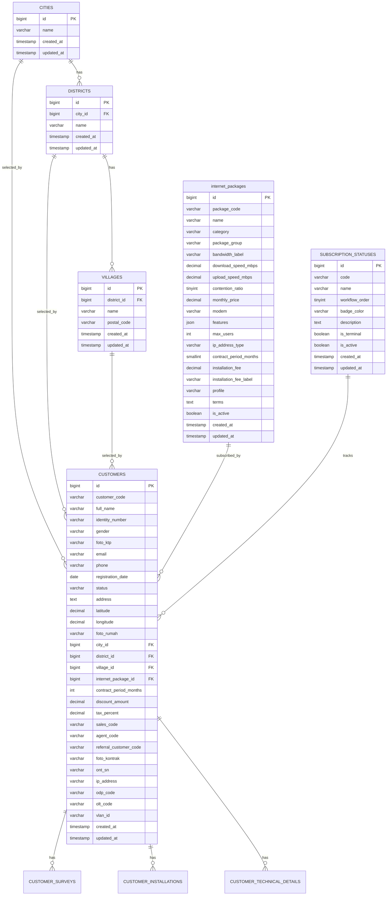

# Database Schema

Dokumen ini merangkum schema database aktual yang dibuat oleh migration project.

## Entity Relationship

## Tabel Master Wilayah

### `cities`

| Kolom | Tipe | Keterangan |
| --- | --- | --- |
| `id` | bigint | Primary key. |
| `name` | varchar(100) | Nama kota/kabupaten, unik. |
| `created_at`, `updated_at` | timestamp | Timestamp Laravel. |

### `districts`

| Kolom | Tipe | Keterangan |
| --- | --- | --- |
| `id` | bigint | Primary key. |
| `city_id` | foreignId | Relasi ke `cities.id`, cascade delete. |
| `name` | varchar(100) | Nama kecamatan. Kombinasi `city_id` dan `name` unik. |
| `created_at`, `updated_at` | timestamp | Timestamp Laravel. |

### `villages`

| Kolom | Tipe | Keterangan |
| --- | --- | --- |
| `id` | bigint | Primary key. |
| `district_id` | foreignId | Relasi ke `districts.id`, cascade delete. |
| `name` | varchar(100) | Nama desa/kelurahan. Kombinasi `district_id` dan `name` unik. |
| `postal_code` | varchar(10), nullable | Kode pos. |
| `created_at`, `updated_at` | timestamp | Timestamp Laravel. |

## Tabel Master Paket Layanan

### `internet_packages`

| Kolom | Tipe | Keterangan |
| --- | --- | --- |
| `id` | bigint | Primary key. |
| `package_code` | varchar(50) | Kode paket, unik. Contoh: `Net150`, `Dedicated100`. |
| `name` | varchar(150) | Nama paket. |
| `category` | varchar(100) | Kategori, misalnya Home Broadband, Bisnis Broadband, UKM, Dedicated. |
| `package_group` | varchar(150) | Grup paket dalam kategori. |
| `bandwidth_label` | varchar(50) | Label bandwidth yang tampil di UI. |
| `download_speed_mbps` | decimal(8,2), nullable | Kecepatan download. |
| `upload_speed_mbps` | decimal(8,2), nullable | Kecepatan upload. |
| `contention_ratio` | tinyint, nullable | Rasio kontensi, misalnya 4 atau 8. |
| `monthly_price` | decimal(12,2) | Harga bulanan. |
| `modem` | varchar(100), nullable | Tipe modem. |
| `features` | json, nullable | Fitur tambahan seperti IPTV, CCTV, AP. |
| `max_users` | int, nullable | Estimasi maksimal user. |
| `ip_address_type` | varchar(100), nullable | Tipe IP. |
| `contract_period_months` | smallint, nullable | Masa kontrak. |
| `installation_fee` | decimal(12,2), nullable | Biaya instalasi. |
| `installation_fee_label` | varchar(150), nullable | Label biaya instalasi. |
| `profile` | varchar(100), nullable | Profil layanan. |
| `terms` | text, nullable | Syarat dan ketentuan. |
| `is_active` | boolean | Status aktif paket. |
| `created_at`, `updated_at` | timestamp | Timestamp Laravel. |

## Tabel Master Status Langganan

### `subscription_statuses`

| Kolom | Tipe | Keterangan |
| --- | --- | --- |
| `id` | bigint | Primary key. |
| `code` | varchar(50) | Kode status, unik. |
| `name` | varchar(100) | Nama status. |
| `workflow_order` | tinyint | Urutan workflow, unik. |
| `badge_color` | varchar(30) | Warna badge UI. |
| `description` | text, nullable | Deskripsi status. |
| `is_terminal` | boolean | Penanda status akhir seperti `terminated` atau `rejected`. |
| `is_active` | boolean | Status aktif master. |
| `created_at`, `updated_at` | timestamp | Timestamp Laravel. |

## Tabel Pelanggan

### `customers`

| Kolom | Tipe | Keterangan |
| --- | --- | --- |
| `id` | bigint | Primary key. |
| `customer_code` | varchar(30) | Kode pelanggan, unik. Format dibuat `WHUS-YYYY-0001`. |
| `full_name` | varchar(150) | Nama lengkap pelanggan. |
| `identity_number` | varchar(50), nullable | Nomor identitas/NIK. |
| `gender` | varchar(20), nullable | Jenis kelamin. |
| `foto_ktp` | varchar, nullable | Path file KTP. |
| `email` | varchar(100), nullable | Email pelanggan. |
| `phone` | varchar(20) | Nomor telepon. |
| `registration_date` | date | Tanggal registrasi. |
| `status` | varchar(50) | Kode status, berelasi secara model ke `subscription_statuses.code`. |
| `address` | text, nullable | Alamat instalasi. |
| `latitude`, `longitude` | decimal | Koordinat lokasi. |
| `foto_rumah` | varchar, nullable | Path foto rumah. |
| `city_id` | foreignId, nullable | Relasi ke `cities.id`, null on delete. |
| `district_id` | foreignId, nullable | Relasi ke `districts.id`, null on delete. |
| `village_id` | foreignId, nullable | Relasi ke `villages.id`, null on delete. |
| `internet_package_id` | foreignId, nullable | Relasi ke `internet_packages.id`, null on delete. |
| `contract_period_months` | int | Masa kontrak. |
| `discount_amount` | decimal(15,2) | Diskon bulanan. |
| `tax_percent` | decimal(5,2) | Persentase pajak. |
| `sales_code` | varchar(30), nullable | Kode sales. |
| `agent_code` | varchar(30), nullable | Kode agent. |
| `referral_customer_code` | varchar(30), nullable | Kode pelanggan referral. |
| `foto_kontrak` | varchar, nullable | Path dokumen kontrak. |
| `ont_sn` | varchar(100), nullable | Serial number ONT. |
| `ip_address` | varchar(45), nullable | IP pelanggan. |
| `odp_code` | varchar(50), nullable | Kode ODP. |
| `olt_code` | varchar(50), nullable | Kode OLT. |
| `vlan_id` | varchar(20), nullable | VLAN layanan. |
| `created_at`, `updated_at` | timestamp | Timestamp Laravel. |

## Tabel Infrastruktur Jaringan

Diperbarui 2026-10-24 (ADHOC-213, Slot/PON sebagai node). Rancangan: `docs/superpowers/specs/2026-10-24-slot-pon-sebagai-node-design.md` (lihat bagian Koreksi D1-D5) dan `docs/plan/infrastruktur/rancangan-hierarki-infrastruktur-server-pop-mini-pop.md`.

Hierarki `Mini POP -> OLT/Switch -> Slot -> PON/Port -> ODP` adalah satu pohon `network_nodes` (`parent_id`). POP diturunkan dari rantai induk lewat `NetworkNode::resolvePop()`; Slot/PON/Port tidak punya `anchor_pop_id`.

### `network_node_types` - tipe node dan aturan induk

Tipe node yang ada: `server`, `olt_chassis` (nama code historis, artinya OLT), `switch_mini_pop`, `odp`, ditambah empat tipe posisi baru (migrasi `2026_10_24_000001_add_position_columns_and_types_to_network_nodes`):

| Code | Nama | Induk sah (`network_node_type_rules`) |
| --- | --- | --- |
| `olt_slot` | Slot OLT | `olt_chassis` |
| `olt_pon` | PON | `olt_slot` |
| `switch_slot` | Slot Switch | `switch_mini_pop` |
| `switch_port` | Port Switch | `switch_slot` |
| `odp` | ODP | `olt_pon` (rule anchor ODP ke Cabang/Mini POP dicabut; hanya menutup penempatan baru, baris lama tidak diubah - D2) |

Tipe lama `odc`, `pon_port`, `olt_card`, `aggregation_switch`, `core_router` sudah dihapus (ADHOC-211/212) dan tidak dihidupkan lagi. Aturan induk ditegakkan di `NetworkNodeService::assertTypePlacement()`.

### `network_nodes` - kolom tambahan

| Kolom | Tipe | Keterangan |
| --- | --- | --- |
| `number` | unsigned smallint, nullable | Nomor Slot/PON/Port, unik per induk. |
| `capacity_unit` | varchar(30), nullable | Satuan kapasitas (mis. pelanggan aktif untuk PON). |
| `is_logical` | boolean, default false | Slot logis (Slot 1 internal Switch dengan port tetap). |
| `record_status` | varchar(30), nullable | Status pendataan (`InfrastructureRecordStatus`: `belum_didata`, `terverifikasi`, `rusak_nonaktif`); `NULL` dibaca `belum_didata`. Terpisah dari `status` (D1). |
| `red_zone_threshold` | unsigned tinyint, nullable | Ambang Red Zone per PON (persen). |
| `code` | varchar(**120**), unique | Dilebarkan dari 50 supaya muat kode turunan (D3); Slot/PON/Port diturunkan otomatis `{kode induk}-S{n}` / `-P{n}`. |

`capacity` dan `status` (`active`/`inactive`) yang sudah ada dipakai ulang: `capacity` pada OLT/Switch = jumlah slot, pada Slot = jumlah PON/Port, pada PON = kapasitas pelanggan aktif.

Indeks: `unique(code)` (global) dan `unique(parent_id, number)` bernama `network_nodes_parent_number_unique` (nomor unik per induk, bukan global).

### Tabel yang dibuang

| Tabel | Migrasi | Pengganti |
| --- | --- | --- |
| `infrastructure_slots` | `2026_10_24_000002_retarget_location_foreign_keys_to_network_nodes` | Node `olt_slot`/`switch_slot` |
| `infrastructure_ports` | idem | Node `olt_pon`/`switch_port` |
| `infrastructure_legacy_mappings` | idem | - (alat legacy dipensiunkan, D4) |
| `olt_slots` | `2026_10_25_000001_drop_olt_slots_table` | Node `olt_slot`; konsep kartu terpasang di slot tidak ada lagi |

Migrasi `000002` bersifat destruktif untuk data posisi lama (slot, port, koneksi, mapping, dan saldo/serial yang lokasinya hanya slot/port itu). Ia menolak jalan di luar `testing` kecuali `INFRA_CONFIRM_DUMMY_RESET=true` (config `infrastructure.confirm_dummy_reset`) **bila ada baris lama yang akan dibuang**, tidak pernah menghapus `network_nodes`/ODP/`network_node_ports`/`network_port_assignments` (D2), dan `down()` melempar exception (tidak dapat dibalik).

### FK lokasi yang diarahkan ulang ke `network_nodes.id`

Nama kolom "slot" dan "port" dipertahankan; hanya target FK yang berpindah (`restrictOnDelete`). Artinya sekarang "node bertipe slot" dan "node bertipe PON/Port Switch".

| Tabel | Kolom |
| --- | --- |
| `inventory_serials` | `current_infrastructure_slot_id`, `current_infrastructure_port_id` |
| `inventory_transactions` | `from_infrastructure_slot_id`, `to_infrastructure_slot_id`, `from_infrastructure_port_id`, `to_infrastructure_port_id` |
| `infrastructure_balances` | `infrastructure_slot_id`, `infrastructure_port_id` |
| `task_infrastructure_actions` | `work_infrastructure_slot_id`, `work_infrastructure_port_id`, `end_from_infrastructure_port_id`, `end_to_infrastructure_port_id` |
| `fop_tasks` | `scope_infrastructure_slot_id`, `scope_infrastructure_port_id` |
| `infrastructure_connections` | `source_infrastructure_port_id`, `target_infrastructure_port_id` |

`infrastructure_connections` kini hanya untuk sambungan Port Switch; ODP ke PON tidak memakainya (uplink = `parent_id`). `network_node_ports` (port fisik ODP yang diisi pelanggan) dan `network_port_assignments` tidak berubah. Kolom `legacy_olt_slot_id`/`legacy_network_node_id` ikut hilang bersama tabelnya.
