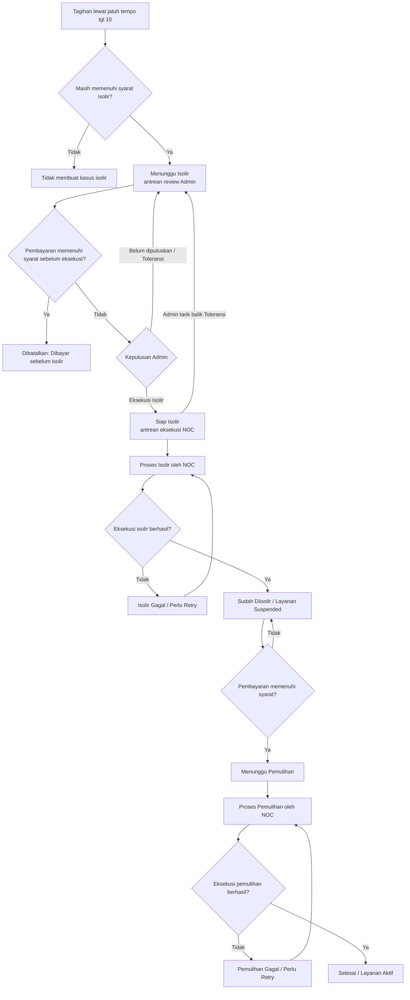
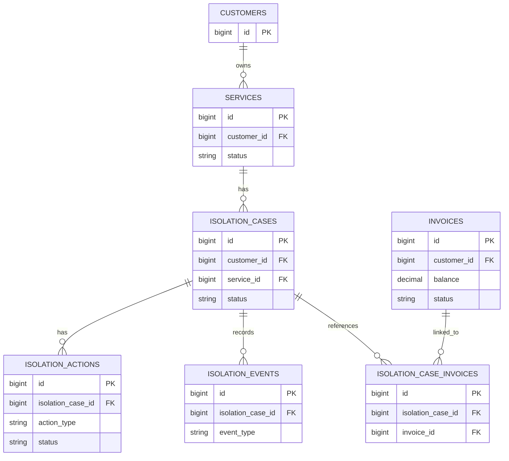

# Rancangan Monitoring Isolir Pelanggan

**Dokumen:** Rancangan Fungsional dan Teknis  
**Modul:** Billing ISP / Customer Management  
**Versi:** 1.0  
**Tanggal:** 19 November 2026  
**Status:** Draft untuk validasi proses bisnis

---

## 1. Ringkasan

Modul Daftar Antrian Isolir saat ini digunakan untuk menampilkan pelanggan yang memiliki piutang melewati jatuh tempo dan perlu ditindaklanjuti oleh NOC. Setelah NOC berhasil melakukan isolir, status layanan pelanggan berubah menjadi `suspended`. Akibatnya, pelanggan keluar dari Daftar Antrian Isolir dan hanya dapat ditemukan melalui daftar pelanggan dengan filter `/customers?status=suspended`.

Perubahan tersebut benar dari sisi status layanan, tetapi menimbulkan masalah operasional. Admin, CS, dan NOC kehilangan konteks tentang ke mana pelanggan berpindah, apakah isolir sudah dilakukan, siapa yang melakukannya, serta apa tindak lanjut berikutnya. Ketika jumlah pelanggan mencapai puluhan atau ratusan, proses pencarian manual akan memakan waktu dan meningkatkan risiko pekerjaan terlewat.

Rancangan ini mengusulkan **Monitoring Isolir** sebagai tempat untuk memantau seluruh siklus kasus isolir, mulai dari pelanggan memenuhi syarat isolir, menunggu tindakan NOC, berhasil diisolir, melakukan pembayaran, menunggu pemulihan, hingga layanan aktif kembali atau kasus dibatalkan.

Prinsip utamanya:

> **Daftar antrean bukan satu-satunya tempat untuk melacak proses isolir. Setiap kasus isolir harus memiliki lifecycle dan riwayat yang dapat ditelusuri, meskipun status layanan dan lokasi tampilan pelanggan berubah.**

Monitoring Isolir tidak menggantikan daftar pelanggan. Keduanya memiliki fungsi berbeda:

- **Monitoring Isolir:** menunjukkan perjalanan kasus, status pekerjaan, pelaksana, dan riwayat tindakan.
- **Daftar Pelanggan Suspended (`/customers?status=suspended`):** menunjukkan kondisi layanan pelanggan saat ini.

---

## 2. Latar Belakang dan Permasalahan

### 2.1 Alur yang berjalan saat ini

1. Pelanggan melewati tanggal jatuh tempo tagihan, yang saat ini ditetapkan setiap tanggal 10.
2. Pelanggan yang masih mempunyai piutang dan memenuhi ketentuan isolir dimasukkan ke Daftar Antrian Isolir.
3. Admin dan CS menggunakan daftar tersebut untuk melihat pelanggan yang perlu ditindaklanjuti.
4. NOC mengeksekusi isolir terhadap pelanggan.
5. Setelah isolir berhasil, status layanan berubah menjadi `suspended`.
6. Pelanggan hilang dari Daftar Antrian Isolir dan berpindah ke daftar `/customers?status=suspended`.
7. Jika pelanggan membayar, sistem perlu mendeteksi pembayaran dan menginformasikan status terbaru kepada Admin, CS, dan NOC.

### 2.2 Masalah operasional

- Pelanggan tampak seperti hilang setelah NOC melakukan isolir.
- Admin, CS, dan NOC harus berpindah halaman atau mencari ulang pelanggan.
- Tidak ada satu tampilan yang menunjukkan seluruh perjalanan kasus isolir dan pemulihan.
- Pembayaran yang diterima belum tentu berarti layanan sudah aktif kembali.
- Admin dan CS dapat mengira pelanggan sudah aktif, padahal NOC belum menyelesaikan pemulihan.
- NOC dapat melewatkan pekerjaan pemulihan apabila tidak tersedia antrean khusus.
- Riwayat tindakan, waktu, dan pelaksana berpotensi tersebar di beberapa halaman atau tidak tercatat secara konsisten.
- Ketika terjadi banyak perubahan dalam waktu berdekatan, pengguna dapat melihat informasi yang tidak sinkron.

### 2.3 Dampak

1. Waktu pencarian dan koordinasi meningkat.
2. Risiko pelanggan terlewat untuk diisolir atau dipulihkan.
3. Status yang dipahami Admin, CS, dan NOC dapat berbeda.
4. Sulit melakukan audit terhadap keputusan dan tindakan isolir.
5. Sulit mengukur kinerja proses isolir dan pemulihan.

---

## 3. Tujuan

Rancangan ini bertujuan untuk:

1. Menyediakan satu halaman pemantauan untuk seluruh kasus isolir dan pemulihan.
2. Memisahkan status tagihan, status layanan, dan status proses isolir.
3. Menjaga riwayat kasus agar tidak hilang ketika status layanan berubah.
4. Membuat pekerjaan isolir dan pemulihan terlihat jelas bagi NOC.
5. Membuat Admin dan CS mengetahui perubahan kondisi pelanggan tanpa harus meminta konfirmasi manual kepada NOC.
6. Mencegah isolir dilakukan berdasarkan data tagihan yang sudah kedaluwarsa atau sudah dibayar.
7. Menyediakan audit trail untuk seluruh perubahan dan tindakan.
8. Mendukung volume kasus yang besar melalui pencarian, filter, pagination, dan pembaruan status yang konsisten.

### 3.1 Di luar cakupan awal

Hal-hal berikut tidak otomatis menjadi bagian dari implementasi tahap pertama dan perlu keputusan atau integrasi tersendiri:

- Otomatisasi perintah isolir/pemulihan ke seluruh merek dan model perangkat jaringan.
- Penentuan kebijakan diskon, dispensasi, atau penghapusan piutang.
- Penetapan masa tenggang baru di luar kebijakan jatuh tempo yang berlaku.
- Penentuan aturan pembagian pembayaran ke beberapa invoice apabila mekanisme alokasi billing belum tersedia.
- Perubahan menyeluruh pada modul billing atau struktur customer yang tidak diperlukan untuk lifecycle isolir.

---

## 4. Prinsip Desain

### 4.1 Pisahkan tiga jenis status

Status berikut tidak boleh dicampur menjadi satu kolom atau satu konsep.

| Jenis status | Contoh | Menjawab pertanyaan |
|---|---|---|
| Status tagihan | Belum lunas, pembayaran sebagian, lunas | Apakah kewajiban pembayaran yang menjadi dasar isolir masih ada? |
| Status layanan | Aktif, suspended | Apakah layanan pelanggan sedang aktif atau terisolir? |
| Status proses isolir | Menunggu isolir, proses isolir, sudah diisolir, menunggu pemulihan, selesai | Sampai di tahap mana penanganan operasionalnya? |

Contoh kombinasi yang valid:

| Status tagihan | Status layanan | Status proses | Makna |
|---|---|---|---|
| Belum lunas | Aktif | Menunggu isolir | Memenuhi syarat dan menunggu tindakan NOC |
| Belum lunas | Aktif | Proses isolir | NOC sedang mengerjakan isolir |
| Belum lunas | Suspended | Sudah diisolir | Isolir berhasil, piutang masih ada |
| Lunas | Suspended | Menunggu pemulihan | Pembayaran memenuhi syarat, layanan belum aktif |
| Lunas | Suspended | Proses pemulihan | NOC sedang mengaktifkan layanan |
| Lunas | Aktif | Selesai | Pemulihan berhasil |
| Lunas | Aktif | Dibatalkan | Pelanggan membayar sebelum isolir dieksekusi |

**Catatan penting:** pembayaran yang diterima tidak boleh langsung mengubah status layanan menjadi aktif. Pembayaran adalah perubahan kondisi billing; pemulihan layanan merupakan tindakan terpisah yang baru dianggap berhasil setelah ada konfirmasi eksekusi.

### 4.2 Lifecycle melekat pada layanan

Kasus isolir sebaiknya merujuk ke `service_id` atau identitas langganan, bukan hanya `customer_id`. Satu pelanggan dapat memiliki lebih dari satu layanan. Tunggakan pada satu layanan tidak boleh secara otomatis mengakibatkan layanan lain ikut terisolir tanpa aturan bisnis yang eksplisit.

### 4.3 Status aktual dan status pekerjaan harus dibedakan

- Status layanan menunjukkan kondisi layanan yang benar-benar berlaku.
- Status proses menunjukkan pekerjaan yang sedang atau telah dilakukan.
- Status pekerjaan NOC menunjukkan hasil eksekusi, misalnya berhasil, gagal, atau perlu dicoba ulang.

### 4.4 Riwayat tidak dihapus

Perubahan status harus menghasilkan event/riwayat baru. Catatan kejadian sebelumnya tidak boleh ditimpa atau dihapus hanya karena status terbaru berubah.

### 4.5 Database adalah sumber kebenaran

Notifikasi dan WebSocket hanya menyampaikan pembaruan ke antarmuka. Kondisi sebenarnya harus selalu dapat dibaca ulang dari database/API. Kegagalan pengiriman notifikasi tidak boleh menyebabkan perubahan status hilang.

---

## 5. Aktor dan Tanggung Jawab

| Aktivitas | Admin | CS | NOC | System |
|---|---:|---:|---:|---:|
| Melihat tagihan/piutang | Ya | Ya | Ya, sesuai kebutuhan | Ya |
| Melihat Monitoring Isolir | Ya | Ya | Ya | Ya |
| Melihat detail kasus dan timeline | Ya | Ya | Ya | Ya |
| Mencatat pembayaran manual | Sesuai otorisasi | Sesuai otorisasi | Tidak | Memproses pembayaran terintegrasi |
| Memvalidasi pembayaran | Sesuai kebijakan | Sesuai kebijakan | Tidak | Memproses hasil verifikasi |
| Mengelola pengecualian isolir | Sesuai otorisasi | Tidak secara default | Tidak secara default | Menerapkan aturan |
| Memulai eksekusi isolir | Tidak | Tidak | Ya | Dapat menjalankan otomatis jika kelak disepakati |
| Mengonfirmasi hasil isolir | Tidak | Tidak | Ya | Mencatat hasil integrasi |
| Memulai eksekusi pemulihan | Tidak | Tidak | Ya | Dapat menjalankan otomatis jika kelak disepakati |
| Mengonfirmasi hasil pemulihan | Tidak | Tidak | Ya | Mencatat hasil integrasi |
| Melihat hasil eksekusi | Ya | Ya | Ya | Ya |
| Melihat audit trail | Ya | Ya | Ya | Ya |

Hak akses final tetap mengikuti matriks RBAC aplikasi. Tabel ini adalah usulan tanggung jawab fungsional, bukan pemberian izin otomatis.

---

## 6. Lifecycle Kasus Isolir

### 6.1 Status yang diusulkan

| Status internal | Label UI | Deskripsi |
|---|---|---|
| `waiting_isolation` | Menunggu Isolir | Pelanggan memenuhi syarat isolir, layanan masih aktif, dan belum ada eksekusi isolir |
| `isolation_in_progress` | Proses Isolir | NOC sedang melakukan tindakan isolir |
| `isolation_failed` | Isolir Gagal | Eksekusi isolir gagal atau belum dapat diverifikasi; perlu tindak lanjut |
| `suspended` | Sudah Diisolir | Status layanan suspended telah berhasil dikonfirmasi |
| `restoration_pending` | Menunggu Pemulihan | Pembayaran memenuhi syarat, tetapi layanan masih suspended |
| `restoration_in_progress` | Proses Pemulihan | NOC sedang melakukan tindakan pemulihan |
| `restoration_failed` | Pemulihan Gagal | Eksekusi pemulihan gagal atau belum dapat diverifikasi; perlu tindak lanjut |
| `completed` | Selesai | Layanan telah berhasil aktif kembali dan kasus ditutup |
| `cancelled` | Dibatalkan | Isolir tidak jadi dilakukan atau kasus dihentikan berdasarkan alasan yang sah |

Status kegagalan disediakan agar kasus tidak diam-diam hilang ketika eksekusi gagal. Status gagal harus dapat dicoba ulang setelah penyebabnya ditangani.

### 6.2 Diagram lifecycle utama

> **Update 2026-11-19** (sesuai implementasi, follow-up permintaan user, DUA
> tahap — dibaca bareng versi diagram di bawah) —
> 1. **Jatuh tempo** (node A) sekarang `due_date` (tgl 10), BUKAN pergantian
>    periode pembukuan — tagihan periode BERJALAN yang lewat tgl 10 ikut
>    masuk (`Invoice::scopeJatuhTempoUntukIsolir()`), beda dari
>    `scopePiutang()` yang tetap dipakai laporan keuangan/dashboard/kolektor.
> 2. **Gerbang Keputusan Admin** ditambahkan SETELAH "Menunggu Isolir" dan
>    SEBELUM "Proses Isolir oleh NOC" — NOC tidak lagi berhak memutuskan
>    sendiri mana yang diisolir/ditoleransi; itu keputusan Admin
>    (`IsolationCaseService::setAdminDecision()`,
>    `CustomerController::toggleSuspend()`).
> 3. **(Tahap 2, hari ini) Gerbang itu sekarang DUA TAB terpisah, bukan cuma
>    kolom `admin_decision` di atas tab yang sama** — begitu Admin pilih
>    "Eksekusi", status kasus beneran PINDAH dari `WAITING_ISOLATION`
>    ("Menunggu Isolir", antrean REVIEW Admin) ke `READY_FOR_ISOLATION`
>    ("Siap Isolir", antrean EKSEKUSI NOC — `IsolationCaseStatus::readyForIsolationGroup()`).
>    NOC tidak pernah melihat/memegang kasus yang masih di tab "Menunggu
>    Isolir", meminimalkan miss komunikasi "NOC pikir sudah di-acc, padahal
>    belum". Admin bisa menarik kasus balik ke "Menunggu Isolir" (pilih
>    "Toleransi" lagi) selama NOC belum eksekusi. Default (belum diputuskan)
>    tetap di "Menunggu Isolir", diperlakukan sama dengan Toleransi.

### 6.3 Skenario alternatif

**A. Pelanggan membayar sebelum NOC memulai isolir**

- Pembayaran harus sudah terverifikasi dan dialokasikan sesuai aturan billing.
- Sistem menghitung ulang piutang yang menjadi dasar isolir.
- Jika syarat isolir tidak lagi terpenuhi, kasus diubah menjadi `cancelled` dengan alasan `paid_before_isolation`.
- Layanan tetap aktif.
- Kasus tetap dapat dilihat pada tab Riwayat.

**B. Pelanggan membayar ketika NOC sedang memproses isolir**

- Sistem dan NOC harus melakukan pemeriksaan ulang sebelum tindakan yang tidak dapat dibatalkan dijalankan.
- Jika pembayaran diterima sebelum perangkat berhasil diisolir, pekerjaan dapat dibatalkan sesuai hasil pemeriksaan dan kondisi aktual.
- Jika perintah isolir sudah berhasil dijalankan, sistem harus memperbarui kondisi aktual menjadi suspended lalu membuat pekerjaan `restoration_pending`.
- Jangan menyimpulkan layanan aktif hanya dari status pembayaran.

**C. Pelanggan membayar setelah berhasil diisolir**

- Jika seluruh kewajiban yang menjadi dasar isolir telah memenuhi ketentuan lunas, kasus berubah menjadi `restoration_pending`.
- Sistem membuat pekerjaan pemulihan bagi NOC.
- Status layanan tetap `suspended` sampai pemulihan berhasil dikonfirmasi.

**D. Pembayaran sebagian**

- Sistem menghitung ulang sisa piutang yang relevan.
- Jika masih memenuhi syarat isolir, kasus tidak berpindah ke pemulihan.
- Jika aturan bisnis menyatakan pembayaran sebagian sudah cukup untuk menghentikan isolir, aturan tersebut harus dikonfigurasi dan diaudit secara eksplisit.

**E. Eksekusi isolir/pemulihan gagal**

- Kasus tidak boleh dihapus dari Monitoring Isolir.
- Simpan waktu, pelaksana, pesan kegagalan, dan informasi percobaan.
- Tampilkan status gagal dan sediakan tindakan retry sesuai otorisasi.
- Retry harus menggunakan identitas tindakan yang dapat mencegah duplikasi.

**F. Pengecualian/manual hold**

- Jika bisnis memerlukan penundaan isolir, sediakan alasan, pemberi persetujuan, masa berlaku, dan jejak audit.
- Pengecualian tidak boleh menghapus riwayat kasus.
- Detail aturan dan pihak yang berhak menyetujui masih perlu ditetapkan.

---

## 7. Aturan Bisnis

### BR-01 — Kelayakan isolir

Sistem hanya membuat kasus isolir jika layanan dan tagihan memenuhi aturan isolir yang telah ditetapkan. Tanggal jatuh tempo yang disebut saat ini adalah tanggal 10 setiap bulan.

### BR-02 — Waktu pemicu

Tanggal dan jam pasti saat pelanggan mulai memenuhi syarat isolir belum ditetapkan secara final. Kandidat kebijakan adalah tanggal 11 pukul 00.00 setelah jatuh tempo tanggal 10, atau waktu lain sesuai masa tenggang yang disetujui bisnis. Nilainya sebaiknya dapat dikonfigurasi.

### BR-03 — Satu kasus aktif per layanan

Sistem tidak boleh membuat beberapa kasus aktif yang bertumpuk untuk layanan yang sama. Jika sudah ada kasus aktif, proses evaluasi berikutnya harus memperbarui atau mengaitkan kewajiban tagihan terkait ke kasus yang berjalan, bukan membuat duplikasi.

### BR-04 — Dasar piutang harus terlacak

Setiap kasus harus dapat ditelusuri ke invoice/tagihan yang menjadi dasar isolir. Nilai piutang, periode, dan invoice terkait harus terekam pada saat kasus dibuat dan dapat direkonsiliasi.

### BR-05 — Pembayaran harus terverifikasi

Hanya pembayaran dengan status terverifikasi/berhasil sesuai aturan billing yang boleh memicu evaluasi pemulihan. Transaksi pending, gagal, dibatalkan, atau belum teralokasi tidak boleh dianggap sebagai pelunasan.

### BR-06 — Pelunasan harus dihitung dari kewajiban yang relevan

Sistem harus menghitung kembali saldo tagihan yang menjadi dasar isolir setelah pembayaran diproses. Definisi apakah pemulihan mensyaratkan seluruh tunggakan pelanggan atau hanya invoice tertentu harus ditetapkan bisnis.

### BR-07 — Status layanan berubah setelah eksekusi terkonfirmasi

Status layanan menjadi `suspended` hanya setelah isolir benar-benar berhasil dilakukan dan hasilnya dikonfirmasi. Status layanan menjadi `active` kembali hanya setelah pemulihan berhasil dikonfirmasi.

### BR-08 — Pembayaran tidak sama dengan pemulihan

Pembayaran yang memenuhi syarat mengubah status proses menjadi `restoration_pending`; bukan langsung mengubah status layanan menjadi aktif.

### BR-09 — Semua perubahan tercatat

Setiap perubahan status, tindakan NOC, pembayaran yang menjadi pemicu, pembatalan, kegagalan, retry, dan pengecualian harus tercatat dalam timeline/audit trail.

### BR-10 — Kasus tidak hilang dari monitoring

Perubahan status layanan tidak boleh menghilangkan rekam kasus dari Monitoring Isolir. Kasus hanya berpindah kelompok/tab berdasarkan status lifecycle.

### BR-11 — Perubahan harus idempotent

Pemrosesan event yang sama lebih dari satu kali tidak boleh membuat kasus, action, notifikasi, atau perubahan layanan ganda.

### BR-12 — Penggunaan identitas layanan

Isolir dan pemulihan dijalankan pada layanan yang tepat, bukan secara membabi buta pada seluruh customer.

---

## 8. Rancangan Halaman Monitoring Isolir

### 8.1 Fungsi halaman

Halaman **Monitoring Isolir** menjadi pusat pemantauan lifecycle. Halaman ini bukan hanya daftar pelanggan yang menunggu tindakan NOC.

### 8.2 Ringkasan/KPI

Usulan kartu ringkasan:

| Ringkasan | Makna |
|---|---|
| Menunggu Isolir | Jumlah kasus yang perlu dieksekusi NOC |
| Proses Isolir | Jumlah kasus yang sedang dikerjakan |
| Sudah Diisolir | Jumlah kasus yang layanan aktualnya suspended karena proses isolir |
| Menunggu Pemulihan | Jumlah pelanggan yang sudah memenuhi syarat pemulihan, tetapi layanan masih suspended |
| Proses Pemulihan | Jumlah pekerjaan pemulihan yang sedang berlangsung |
| Gagal / Perlu Tindakan | Jumlah eksekusi gagal yang membutuhkan penanganan |
| Selesai Hari Ini | Jumlah kasus yang pemulihannya berhasil pada hari berjalan |

Angka pada kartu harus mengikuti filter yang berlaku dan menggunakan waktu lokal aplikasi (`Asia/Jakarta`). Definisi metrik dan rentang waktu harus konsisten.

### 8.3 Tab utama

| Tab | Data yang ditampilkan | Pengguna utama |
|---|---|---|
| Menunggu Isolir | Kasus `waiting_isolation`, `isolation_in_progress`, `isolation_failed` | Admin, CS, NOC |
| Sudah Diisolir | Kasus `suspended` | Admin, CS, NOC |
| Pemulihan | Kasus `restoration_pending`, `restoration_in_progress`, `restoration_failed` | Admin, CS, NOC |
| Riwayat | Kasus `completed` dan `cancelled` | Admin, CS, NOC |

Status proses yang sedang berjalan atau gagal boleh ditampilkan sebagai badge/substatus di tab yang relevan agar navigasi tidak berlebihan.

### 8.4 Kolom tabel yang disarankan

| Kolom | Keterangan |
|---|---|
| Nomor kasus | ID unik kasus isolir |
| ID pelanggan | ID customer |
| ID layanan | ID service/langganan yang terkena isolir |
| Nama pelanggan | Nama pemilik layanan |
| POP/Cabang | Lokasi operasional layanan |
| Periode tagihan | Periode kewajiban yang menjadi dasar isolir |
| Total piutang | Saldo kewajiban terkait |
| Status tagihan | Belum lunas, sebagian, atau lunas |
| Status layanan | Aktif atau suspended |
| Status proses | Status lifecycle isolir |
| Waktu perubahan terakhir | Waktu event terakhir yang relevan |
| Pelaksana terakhir | Admin, CS, NOC, atau System |
| Aksi | Detail, timeline, atau tindakan sesuai hak akses |

Kolom dapat disesuaikan berdasarkan kebutuhan layar. Untuk tabel dengan banyak data, gunakan pagination server-side.

### 8.5 Pencarian dan filter

Pencarian minimal:

- ID pelanggan.
- ID layanan.
- Nama pelanggan.
- Nomor kasus.
- Nomor invoice/tagihan jika relevan.

Filter yang disarankan:

- POP/Cabang.
- Status proses.
- Status tagihan.
- Status layanan.
- Rentang tanggal dibuat.
- Rentang tanggal isolir.
- Rentang tanggal pembayaran.
- Pelaksana NOC.
- Kasus gagal/perlu tindakan.

### 8.6 Detail kasus

Halaman/detail drawer kasus minimal menampilkan:

1. Identitas pelanggan dan layanan.
2. Informasi POP/Cabang.
3. Invoice dan periode tagihan yang menjadi dasar isolir.
4. Rincian piutang saat kasus dibuat dan saldo terbaru.
5. Status tagihan aktual.
6. Status layanan aktual.
7. Status lifecycle kasus.
8. Informasi isolir: waktu, pelaksana, hasil, dan catatan.
9. Informasi pembayaran yang menjadi pemicu pemulihan.
10. Informasi pemulihan: waktu, pelaksana, hasil, dan catatan.
11. Timeline seluruh event.
12. Riwayat retry/kegagalan jika ada.

### 8.7 Aksi berdasarkan status dan hak akses

| Status | Aksi NOC | Aksi Admin/CS |
|---|---|---|
| Menunggu Isolir | Mulai isolir | Lihat detail; validasi data melalui modul yang berwenang |
| Proses Isolir | Lanjutkan/konfirmasi sesuai workflow | Lihat progres |
| Isolir Gagal | Lihat kegagalan; retry sesuai otorisasi | Lihat alasan kegagalan |
| Sudah Diisolir | Lihat detail; tidak perlu mengisolir ulang | Lihat kondisi dan riwayat |
| Menunggu Pemulihan | Mulai pemulihan | Lihat pembayaran dan antrean pemulihan |
| Proses Pemulihan | Lanjutkan/konfirmasi sesuai workflow | Lihat progres |
| Pemulihan Gagal | Lihat kegagalan; retry sesuai otorisasi | Lihat alasan kegagalan |
| Selesai | Lihat riwayat | Lihat riwayat |
| Dibatalkan | Lihat alasan pembatalan | Lihat alasan pembatalan |

Aksi yang berpotensi mengubah kondisi layanan harus dibatasi pada peran yang berwenang dan memerlukan konfirmasi yang memadai.

---

## 9. Hubungan dengan Halaman Pelanggan

### 9.1 Daftar pelanggan suspended tetap dipertahankan

Route `/customers?status=suspended` tetap digunakan untuk mencari pelanggan berdasarkan **status layanan aktual**.

Monitoring Isolir digunakan untuk mencari berdasarkan **kasus dan lifecycle**.

### 9.2 Perilaku setelah isolir berhasil

Ketika isolir berhasil:

- Kasus keluar dari tab Menunggu Isolir.
- Kasus masuk ke tab Sudah Diisolir.
- Status layanan pelanggan berubah menjadi `suspended`.
- Pelanggan muncul pada `/customers?status=suspended`.
- Kasus isolir dan seluruh event tetap tersimpan.
- Detail pelanggan menyediakan tautan ke detail kasus isolir terkait.

### 9.3 Perilaku setelah pembayaran

Ketika pembayaran memenuhi syarat pemulihan:

- Kasus berpindah ke tab Pemulihan.
- Status layanan masih `suspended`.
- Pelanggan tetap muncul di `/customers?status=suspended` sampai pemulihan berhasil.
- Setelah pemulihan berhasil, status layanan berubah menjadi `active` dan pelanggan tidak lagi muncul pada filter suspended.
- Kasus berpindah ke tab Riwayat dengan status `completed`.

### 9.4 Deep link

Dari halaman pelanggan, pengguna sebaiknya dapat membuka kasus isolir yang terkait. Dari detail kasus, pengguna juga dapat membuka profil pelanggan dan layanan terkait.

---

## 10. Mekanisme Pembayaran dan Pemulihan

### 10.1 Pemicu

Pemicu utama adalah event pembayaran yang telah terverifikasi, bukan sekadar input nominal atau perubahan status yang belum final.

### 10.2 Alur sistem

1. Billing menerima/mencatat pembayaran.
2. Sistem memvalidasi status transaksi.
3. Sistem mengalokasikan pembayaran ke invoice sesuai aturan billing.
4. Sistem menghitung ulang saldo piutang yang menjadi dasar kasus.
5. Sistem menemukan kasus isolir aktif untuk layanan terkait.
6. Sistem mengevaluasi kelayakan pemulihan.
7. Jika kewajiban telah memenuhi aturan lunas dan layanan masih suspended, sistem mengubah kasus menjadi `restoration_pending`.
8. Sistem membuat pekerjaan pemulihan untuk NOC.
9. Sistem mencatat event dan menerbitkan pembaruan ke antarmuka Admin, CS, dan NOC.
10. NOC menjalankan pemulihan.
11. Sistem memverifikasi hasil pemulihan.
12. Jika berhasil, status layanan menjadi aktif dan kasus menjadi `completed`.

### 10.3 Notifikasi yang disarankan

**Saat pembayaran diterima dan menunggu pemulihan:**

- Judul: `Pembayaran diterima — pemulihan menunggu tindakan`.
- Informasi: nama pelanggan, ID layanan, jumlah pembayaran, sisa piutang, status layanan, dan nomor kasus.
- Status: tagihan lunas (sesuai evaluasi), layanan masih suspended, proses menunggu pemulihan.

**Saat pemulihan berhasil:**

- Judul: `Layanan berhasil aktif kembali`.
- Informasi: nama pelanggan, ID layanan, waktu pemulihan, pelaksana, dan nomor kasus.
- Status: tagihan, layanan, dan kasus ditampilkan secara terpisah.

Notifikasi adalah alat bantu. Status pada database dan halaman monitoring tetap menjadi sumber kebenaran.

---

## 11. Penanganan Race Condition dan Konsistensi Data

Skenario kritis: NOC sedang membuka kasus untuk melakukan isolir, sementara pembayaran pelanggan masuk pada waktu yang hampir bersamaan.

### 11.1 Aturan pemeriksaan ulang

Sebelum mengeksekusi isolir, backend wajib:

1. Memuat ulang kasus dan status layanan terbaru.
2. Memuat ulang status transaksi dan saldo kewajiban terkait.
3. Mengevaluasi ulang kelayakan isolir.
4. Memastikan belum ada action aktif atau action berhasil untuk kasus tersebut.
5. Menjalankan tindakan hanya jika seluruh prasyarat masih terpenuhi.

### 11.2 Aturan setelah perintah jaringan dijalankan

Jika pembayaran masuk ketika proses jaringan sedang berjalan:

- Sistem tidak boleh mengasumsikan hasil perangkat.
- Sistem harus mengambil hasil aktual eksekusi isolir.
- Jika isolir belum dilakukan dan dapat dibatalkan dengan aman, hentikan tindakan dan catat pembatalan.
- Jika isolir sudah berhasil, catat layanan sebagai suspended dan buat pekerjaan pemulihan.
- Jika hasil belum diketahui, gunakan status proses yang menunjukkan verifikasi tertunda; jangan menyatakan layanan aktif atau suspended tanpa dasar.

### 11.3 Kontrol teknis

- **Database transaction:** gunakan transaksi saat membuat/memperbarui kasus dan pekerjaan terkait.
- **Row locking/optimistic locking:** cegah dua proses mengubah kasus yang sama tanpa koordinasi.
- **Idempotency key:** setiap perintah/action memiliki kunci unik agar retry atau event duplikat tidak menggandakan tindakan.
- **Unique constraint/guard:** cegah kasus aktif ganda untuk layanan yang sama.
- **Outbox pattern atau mekanisme event yang tahan gagal:** pastikan perubahan database dan publikasi event dapat direkonsiliasi.
- **Retry policy:** retry terkontrol dengan batas percobaan dan pencatatan error.
- **Reconciliation job:** job berkala untuk membandingkan status layanan, status kasus, dan hasil eksekusi perangkat/integrasi.

---

## 12. Rancangan Data

Rancangan berikut adalah model konseptual. Nama tabel, tipe kolom, dan relasi final perlu disesuaikan dengan skema database aplikasi yang sudah ada.

### 12.1 `isolation_cases`

Menyimpan satu record untuk satu siklus kasus isolir pada suatu layanan.

| Kolom | Tipe konseptual | Keterangan |
|---|---|---|
| `id` | BIGINT/UUID | Primary key |
| `case_number` | VARCHAR | Nomor kasus yang dapat dibaca pengguna, unik |
| `customer_id` | FK | Referensi pelanggan |
| `service_id` | FK | Referensi layanan yang menjadi target isolir |
| `status` | VARCHAR/ENUM | Status lifecycle kasus |
| `trigger_type` | VARCHAR | Sumber pemicu, misalnya overdue billing |
| `billing_period` | VARCHAR/DATE | Periode tagihan yang menjadi dasar |
| `outstanding_amount_at_creation` | DECIMAL | Piutang pada saat kasus dibuat |
| `current_outstanding_amount` | DECIMAL | Saldo kewajiban relevan terbaru |
| `detected_at` | DATETIME | Waktu sistem mendeteksi syarat isolir |
| `isolation_started_at` | DATETIME nullable | Waktu isolir mulai dikerjakan |
| `suspended_at` | DATETIME nullable | Waktu isolir berhasil dikonfirmasi |
| `paid_at` | DATETIME nullable | Waktu kewajiban memenuhi syarat pemulihan |
| `restoration_started_at` | DATETIME nullable | Waktu pemulihan mulai dikerjakan |
| `restored_at` | DATETIME nullable | Waktu pemulihan berhasil dikonfirmasi |
| `closed_at` | DATETIME nullable | Waktu kasus ditutup |
| `cancelled_at` | DATETIME nullable | Waktu kasus dibatalkan |
| `cancellation_reason` | VARCHAR nullable | Alasan pembatalan |
| `created_at` | DATETIME | Waktu record dibuat |
| `updated_at` | DATETIME | Waktu record diperbarui |

Catatan:

- `customer_id` berguna untuk pencarian dan pelaporan, tetapi tindakan harus mengacu ke `service_id`.
- Snapshot nilai piutang diperlukan agar alasan awal kasus dapat diaudit. Saldo terbaru harus tetap dihitung dari billing, bukan mengandalkan snapshot lama.
- Apabila satu kasus dapat mencakup beberapa invoice, gunakan tabel relasi invoice, bukan hanya satu `billing_period`.

### 12.2 `isolation_case_invoices`

Menghubungkan kasus isolir dengan invoice/tagihan yang menjadi dasar kasus.

| Kolom | Tipe konseptual | Keterangan |
|---|---|---|
| `id` | BIGINT/UUID | Primary key |
| `isolation_case_id` | FK | Referensi kasus |
| `invoice_id` | FK | Referensi invoice |
| `amount_at_link` | DECIMAL | Nilai yang menjadi dasar saat dikaitkan |
| `created_at` | DATETIME | Waktu relasi dibuat |

Tabel ini membantu audit apabila satu pelanggan memiliki beberapa invoice atau tunggakan lintas periode.

### 12.3 `isolation_events`

Menyimpan timeline/audit trail. Record event sebaiknya append-only.

| Kolom | Tipe konseptual | Keterangan |
|---|---|---|
| `id` | BIGINT/UUID | Primary key |
| `isolation_case_id` | FK | Referensi kasus |
| `event_type` | VARCHAR | Jenis kejadian |
| `from_status` | VARCHAR nullable | Status sebelum perubahan |
| `to_status` | VARCHAR nullable | Status sesudah perubahan |
| `actor_type` | VARCHAR | `user`, `system`, atau integrasi |
| `actor_id` | FK nullable | ID pengguna bila dilakukan user |
| `description` | TEXT | Ringkasan kejadian |
| `metadata` | JSON nullable | Informasi tambahan yang tidak sensitif |
| `occurred_at` | DATETIME | Waktu kejadian sebenarnya |
| `created_at` | DATETIME | Waktu event dicatat |

Contoh `event_type`:

- `case_created`
- `isolation_started`
- `isolation_succeeded`
- `isolation_failed`
- `payment_verified`
- `restoration_queued`
- `restoration_started`
- `restoration_succeeded`
- `restoration_failed`
- `case_cancelled`
- `retry_requested`
- `manual_hold_applied`
- `manual_hold_released`

### 12.4 `isolation_actions`

Menyimpan pekerjaan/eksekusi yang perlu dilakukan NOC atau integrasi sistem.

| Kolom | Tipe konseptual | Keterangan |
|---|---|---|
| `id` | BIGINT/UUID | Primary key |
| `isolation_case_id` | FK | Referensi kasus |
| `action_type` | VARCHAR | `suspend` atau `restore` |
| `status` | VARCHAR | `queued`, `in_progress`, `succeeded`, `failed`, `cancelled` |
| `idempotency_key` | VARCHAR | Kunci unik pencegah duplikasi |
| `attempt_number` | INTEGER | Nomor percobaan |
| `requested_by` | FK nullable | Pengguna yang memulai, jika manual |
| `executed_by` | FK nullable | Pengguna/aktor eksekusi |
| `started_at` | DATETIME nullable | Waktu mulai |
| `finished_at` | DATETIME nullable | Waktu selesai |
| `result_code` | VARCHAR nullable | Kode hasil |
| `result_message` | TEXT nullable | Hasil atau pesan kegagalan |
| `device_reference` | VARCHAR nullable | Referensi perangkat/integrasi jika tersedia |
| `metadata` | JSON nullable | Data teknis tambahan |
| `created_at` | DATETIME | Waktu dibuat |
| `updated_at` | DATETIME | Waktu diperbarui |

### 12.5 Relasi konseptual

### 12.6 Indeks dan constraint yang dipertimbangkan

- Unique index pada `case_number`.
- Index pada `service_id`, `status`, `detected_at`, `suspended_at`, `paid_at`, dan `restored_at` sesuai pola pencarian.
- Unique index pada `idempotency_key`.
- Foreign key untuk relasi pelanggan, layanan, invoice, kasus, event, dan action.
- Guard/constraint untuk mencegah lebih dari satu kasus aktif per layanan.
- Index gabungan sesuai kebutuhan filter POP/Cabang jika field tersebut disimpan atau tersedia melalui relasi layanan.

Untuk MySQL, strategi mencegah kasus aktif ganda perlu mengikuti versi dan desain skema yang digunakan. Jika partial unique index tidak tersedia, gunakan mekanisme transaksi/locking dan kolom kunci aktif yang dapat diberi unique constraint.

---

## 13. Event dan Pembaruan Real-Time

### 13.1 Event domain yang diusulkan

| Event | Pemicu | Dampak |
|---|---|---|
| `IsolationCaseCreated` | Layanan memenuhi syarat isolir | Kasus muncul pada Menunggu Isolir |
| `IsolationStarted` | NOC memulai tindakan | Status proses menjadi Proses Isolir |
| `IsolationSucceeded` | Isolir terkonfirmasi berhasil | Status layanan suspended; kasus masuk Sudah Diisolir |
| `IsolationFailed` | Eksekusi isolir gagal | Kasus masuk kondisi gagal/perlu tindakan |
| `PaymentVerified` | Pembayaran terverifikasi | Billing menghitung ulang saldo relevan |
| `RestorationQueued` | Syarat pemulihan terpenuhi | Kasus masuk tab Pemulihan |
| `RestorationStarted` | NOC memulai pemulihan | Status proses menjadi Proses Pemulihan |
| `RestorationSucceeded` | Pemulihan terkonfirmasi berhasil | Status layanan aktif; kasus selesai |
| `RestorationFailed` | Eksekusi pemulihan gagal | Kasus masuk kondisi gagal/perlu tindakan |
| `IsolationCaseCancelled` | Isolir tidak perlu dilanjutkan | Kasus masuk Riwayat dengan alasan pembatalan |

### 13.2 Pembaruan tampilan

Jika aplikasi menggunakan Laravel Reverb/WebSocket:

- Broadcast event setelah perubahan database berhasil di-commit.
- Channel harus memiliki otorisasi sesuai role dan cakupan POP/Cabang.
- UI memperbarui badge, KPI, dan daftar terkait ketika event diterima.
- Jika koneksi terputus, halaman mengambil ulang data dari API/database ketika tersambung kembali.
- Event broadcast tidak boleh menjadi satu-satunya penyimpanan perubahan.

### 13.3 Notifikasi

Notifikasi dapat ditampilkan di dalam aplikasi dan/atau kanal lain sesuai kebijakan. Notifikasi tidak perlu dikirim untuk setiap perubahan teknis kecil; prioritaskan kejadian yang mengubah pekerjaan atau kondisi pelanggan:

- Kasus baru menunggu isolir.
- Isolir berhasil/gagal.
- Pembayaran memenuhi syarat pemulihan.
- Pemulihan berhasil/gagal.
- Kasus dibatalkan atau memerlukan perhatian.

---

## 14. Audit, Keamanan, dan Validasi

1. Semua aksi yang mengubah status layanan harus memeriksa autentikasi dan otorisasi.
2. Catat aktor, timestamp, status sebelum/sesudah, alasan, dan hasil eksekusi.
3. Pengguna tidak boleh mengubah atau menghapus event historis melalui UI biasa.
4. Hindari menyimpan kredensial router, token, atau informasi rahasia ke kolom metadata event.
5. Batasi isi `metadata` agar tidak menyimpan data pribadi berlebihan.
6. Validasi bahwa layanan terkait masih benar-benar milik pelanggan yang tercantum.
7. Validasi status layanan aktual sebelum dan setelah action.
8. Pastikan aksi retry memiliki batas percobaan dan tidak membuat duplikasi perintah.
9. Perubahan manual atau override wajib menyertakan alasan dan aktor yang berwenang.
10. Semua waktu disimpan dengan standar zona waktu database yang konsisten dan ditampilkan dalam `Asia/Jakarta`.

---

## 15. Laporan dan Indikator Operasional

Setelah data lifecycle tersedia, sistem dapat menyediakan laporan berikut:

- Jumlah pelanggan yang masuk antrean isolir per hari/periode.
- Jumlah isolir berhasil dan gagal.
- Jumlah pelanggan yang membayar sebelum isolir dieksekusi.
- Jumlah pelanggan yang menunggu pemulihan.
- Jumlah pemulihan berhasil dan gagal.
- Rata-rata waktu dari masuk antrean sampai isolir.
- Rata-rata waktu dari pembayaran terverifikasi sampai pemulihan berhasil.
- Jumlah kasus yang melewati SLA internal.
- Distribusi kasus berdasarkan POP/Cabang dan pelaksana NOC.

Definisi SLA, target waktu, dan rumus laporan perlu disepakati secara operasional sebelum dijadikan KPI kinerja.

---

## 16. Kriteria Penerimaan

Implementasi dapat dianggap memenuhi rancangan awal apabila skenario berikut berhasil diuji.

### AC-01 — Pelanggan memenuhi syarat isolir

- Sistem membuat satu kasus untuk layanan yang memenuhi aturan.
- Kasus muncul pada tab Menunggu Isolir.
- Informasi invoice, saldo, pelanggan, layanan, dan waktu deteksi tersedia.

### AC-02 — NOC berhasil mengisolir

- NOC dapat memulai dan menyelesaikan pekerjaan isolir sesuai hak akses.
- Status layanan berubah menjadi suspended hanya setelah berhasil dikonfirmasi.
- Kasus berpindah dari Menunggu Isolir ke Sudah Diisolir.
- Pelanggan tetap muncul pada `/customers?status=suspended`.
- Timeline merekam waktu, aktor, dan hasil.

### AC-03 — Pembayaran sebelum isolir

- Pembayaran terverifikasi memicu penghitungan ulang piutang.
- Jika syarat isolir tidak lagi terpenuhi sebelum isolir dieksekusi, kasus dibatalkan dengan alasan yang jelas.
- Layanan tetap aktif.
- Kasus tersedia di Riwayat.

### AC-04 — Pembayaran setelah isolir

- Pembayaran yang memenuhi syarat mengubah kasus menjadi Menunggu Pemulihan.
- Status layanan tetap suspended.
- Pelanggan masih muncul pada `/customers?status=suspended`.
- NOC melihat pekerjaan pemulihan.

### AC-05 — Pemulihan berhasil

- NOC dapat memproses pemulihan.
- Status layanan berubah menjadi aktif setelah hasil berhasil dikonfirmasi.
- Kasus menjadi Selesai.
- Pelanggan tidak lagi muncul pada filter suspended.
- Timeline merekam seluruh tahapan.

### AC-06 — Eksekusi gagal

- Kasus tidak hilang ketika isolir atau pemulihan gagal.
- Pesan kegagalan dan jumlah percobaan tersimpan.
- NOC dapat melakukan retry sesuai otorisasi.
- Retry tidak menghasilkan tindakan ganda.

### AC-07 — Event pembayaran duplikat

- Event pembayaran yang sama diproses lebih dari sekali tidak membuat beberapa pekerjaan pemulihan.
- Status dan saldo tetap konsisten.

### AC-08 — Race condition pembayaran dan isolir

- Ketika pembayaran masuk bersamaan dengan proses isolir, sistem melakukan pemeriksaan ulang.
- Status aktual mengikuti hasil eksekusi yang terkonfirmasi.
- Tidak ada kasus yang dinyatakan aktif ketika perangkat masih mengisolir layanan.

### AC-09 — Akses lintas role

- Admin, CS, dan NOC dapat melihat informasi sesuai hak akses.
- Hanya role yang berwenang yang dapat mengeksekusi isolir/pemulihan atau melakukan override.

### AC-10 — Pencarian dan skala data

- Pengguna dapat mencari pelanggan berdasarkan ID, nama, layanan, dan nomor kasus.
- Filter POP/Cabang dan status berfungsi.
- Tabel menggunakan pagination dan tidak perlu memuat seluruh data sekaligus.

---

## 17. Tahapan Implementasi yang Disarankan

### Tahap 1 — Audit proses dan data yang sudah ada

- Petakan status pelanggan dan layanan saat ini.
- Petakan sumber data invoice, pembayaran, dan saldo piutang.
- Audit proses isolir NOC yang berjalan sekarang.
- Identifikasi apakah keberhasilan isolir/pemulihan berasal dari konfirmasi manual atau integrasi perangkat.
- Identifikasi halaman, route, job, dan event yang sudah tersedia.

**Output:** peta proses existing, daftar gap, dan keputusan bisnis yang dibutuhkan.

### Tahap 2 — Finalisasi business rules

- Tetapkan waktu cutoff isolir setelah tanggal 10.
- Tetapkan syarat pelunasan untuk pemulihan.
- Tetapkan perlakuan pembayaran sebagian.
- Tetapkan pengecualian/penundaan isolir.
- Tetapkan apakah pemulihan manual, otomatis, atau hybrid.
- Tetapkan peran yang berwenang.

**Output:** business rules final dan matriks hak akses.

### Tahap 3 — Data model dan backend lifecycle

- Buat tabel kasus, event, action, dan relasi invoice jika diperlukan.
- Implementasikan service untuk membuat/memperbarui kasus.
- Implementasikan idempotency dan concurrency control.
- Hubungkan event pembayaran terverifikasi.
- Implementasikan perubahan status hanya berdasarkan hasil eksekusi yang valid.

**Output:** lifecycle dapat berjalan dan tercatat tanpa bergantung pada UI.

### Tahap 4 — UI Monitoring Isolir

- Buat ringkasan KPI.
- Buat tab Menunggu Isolir, Sudah Diisolir, Pemulihan, dan Riwayat.
- Buat tabel dengan pencarian/filter/pagination.
- Buat detail kasus dan timeline.
- Hubungkan ke profil pelanggan dan halaman suspended.
- Terapkan RBAC pada seluruh aksi.

**Output:** Admin, CS, dan NOC memiliki satu tempat untuk memantau kasus.

### Tahap 5 — Real-time, notifikasi, dan rekonsiliasi

- Broadcast perubahan melalui mekanisme real-time yang digunakan aplikasi.
- Tambahkan notifikasi untuk kejadian penting.
- Tambahkan job rekonsiliasi untuk mendeteksi status yang tidak sinkron.
- Tambahkan monitoring error dan retry.

**Output:** perubahan terlihat oleh seluruh peran dan ketidaksesuaian dapat dideteksi.

### Tahap 6 — UAT dan rollout bertahap

- Uji kasus normal dan kasus batas.
- Uji event pembayaran duplikat.
- Uji pembayaran bersamaan dengan eksekusi isolir.
- Uji isolir/pemulihan gagal.
- Uji volume data dan hak akses POP/Cabang.
- Jalankan pilot pada cakupan terbatas sebelum digunakan secara penuh.

**Output:** hasil UAT, daftar perbaikan, dan keputusan rollout.

---

## 18. Open Decisions yang Harus Disepakati

Poin berikut belum dapat dianggap sebagai keputusan final.

| No. | Pertanyaan | Opsi/keterangan | Dampak |
|---|---|---|---|
| 1 | Kapan pelanggan mulai memenuhi syarat isolir? | Tanggal 11 pukul 00.00, atau setelah masa tenggang tertentu | Menentukan scheduler dan eligibility |
| 2 | Apa definisi lunas untuk pemulihan? | Semua invoice tertunggak, invoice yang menjadi dasar isolir, atau aturan lain | Menentukan kapan `restoration_pending` dibuat |
| 3 | Bagaimana pembayaran memicu pemulihan? | Otomatis membuat pekerjaan setelah pembayaran terverifikasi, atau perlu validasi Admin | Menentukan alur billing dan otorisasi |
| 4 | Bagaimana NOC melakukan pemulihan? | Manual, otomatis melalui perangkat, atau hybrid | Menentukan integrasi dan workflow NOC |
| 5 | Bagaimana pembayaran sebagian diperlakukan? | Tetap menunggu isolir, menghentikan isolir, atau mengikuti aturan nominal tertentu | Menentukan evaluasi piutang |
| 6 | Apakah ada dispensasi/hold isolir? | Siapa yang boleh memberi, alasan, masa berlaku, dan persetujuan | Menentukan kontrol pengecualian |
| 7 | Bagaimana hasil isolir diverifikasi? | Konfirmasi NOC, pembacaan status perangkat, atau kombinasi | Menentukan kapan status layanan berubah |
| 8 | Apakah satu kasus mencakup beberapa invoice/periode? | Tentukan strategi pengelompokan kewajiban | Menentukan relasi tabel dan rekonsiliasi |
| 9 | Bagaimana layanan dengan beberapa perangkat/komponen jaringan ditangani? | Satu action atau beberapa sub-action | Menentukan desain eksekusi teknis |
| 10 | Berapa lama kasus selesai/riwayat disimpan dan siapa yang boleh mengaksesnya? | Mengikuti kebijakan audit dan retensi data | Menentukan kebijakan penyimpanan dan akses |

---

## 19. Rekomendasi Akhir

Rekomendasi utama adalah membangun **Monitoring Isolir berbasis lifecycle kasus**, bukan sekadar mempertahankan atau memindahkan daftar pelanggan antarhalaman.

Tiga lapisan fungsional yang disarankan:

1. **Billing & Payment** — menentukan jatuh tempo, piutang, pembayaran, alokasi invoice, dan kelayakan isolir/pemulihan.
2. **Isolation Lifecycle / Monitoring** — mencatat kasus, status proses, event, dan timeline dari awal hingga selesai.
3. **NOC Execution** — mengelola pekerjaan isolir dan pemulihan serta mengonfirmasi hasil eksekusi.

Hasil yang diharapkan:

- Pelanggan tidak lagi terasa hilang ketika berpindah dari antrean ke status suspended.
- Semua pihak menggunakan informasi status yang sama.
- Admin dan CS dapat mengetahui apakah pelanggan sudah membayar, masih suspended, atau sudah aktif kembali.
- NOC mempunyai antrean pekerjaan isolir dan pemulihan yang jelas.
- Riwayat tindakan dapat ditelusuri untuk audit dan penyelesaian masalah.
- Proses tetap dapat dikendalikan ketika volume pelanggan meningkat.

**Keputusan implementasi terpenting:** jangan mengubah status layanan hanya berdasarkan status tagihan. Status layanan harus mengikuti hasil eksekusi isolir/pemulihan yang telah dikonfirmasi. Sementara itu, lifecycle kasus harus tetap tersimpan dan dapat ditelusuri dari Monitoring Isolir.

---

## 21. Addendum Implementasi Laravel (2026-11-19)

Status: **disetujui user untuk rebuild penuh** (bukan patch minimal di atas
`isolir_queue_entries` — lihat `docs/plan/rancangan-list-isolir.md`, yang
jadi **DIGANTIKAN** dokumen ini untuk desain antrean/lifecycle. Implementasi
awal ADHOC-306 (belum commit) akan diganti total, bukan ditambah.

### 21.1 Resolusi Open Decisions (§18) untuk batch pertama

Keputusan default teknis dipilih supaya Tahap 3 bisa mulai tanpa menunggu
keputusan bisnis yang belum krusial untuk versi pertama. Yang beneran
mengubah perilaku terlihat user ditandai **[KONFIRMASI]** — defaultnya
dipakai kalau user tidak koreksi.

| # | Keputusan default | Alasan |
|---|---|---|
| 1 | **[KONFIRMASI]** Kasus dibuat LAZY (dihitung saat halaman/command jalan), bukan scheduled job jam presisi. Command `php artisan isolir:sync-cases` (jadwal harian lewat scheduler existing) membuat `waiting_isolation` untuk layanan yang piutang (`Invoice::scopePiutang()`) dan belum punya kasus aktif. | Belum ada infra scheduler khusus utk ini; command harian cukup untuk operasional sekarang, bisa diperketat jadi tanggal 11 jam 00:00 nanti tanpa ubah skema. |
| 2 | **[KONFIRMASI]** Lunas = SEMUA invoice yang tersnapshot di `isolation_case_invoices` untuk kasus itu `remaining_amount = 0`. BUKAN seluruh piutang pelanggan di luar kasus. | Konsisten BR-04/BR-06, kasus kasus baru dibuat kalau piutang baru lagi. |
| 3 | Pembayaran terverifikasi (`InvoiceStatusUpdated`, invoice jadi lunas) otomatis membuat `restoration_pending` TANPA validasi Admin tambahan — NOC yang eksekusi aktivasi manual. | Konsisten keputusan awal "cukup di sistem, manual belum ada integrasi hardware" — approval tambahan Admin belum diminta siapa pun. |
| 4 | Pemulihan: NOC klik "Aktifkan Kembali" → `restore` action dieksekusi SINKRON (klik = `succeeded` seketika, `started_at = finished_at = now()`). Belum ada status `in_progress` menggantung karena belum ada integrasi perangkat. | Sesuai keputusan awal: manual, sistem-only. Kolom status disiapkan penuh supaya nanti tinggal diisi async tanpa migrasi ulang. |
| 5 | **[KONFIRMASI]** Pembayaran sebagian: kasus TETAP `waiting_isolation`/`suspended` (tidak masuk `restoration_pending`) sampai sisa di invoice snapshot kasus itu 0. | Default paling aman (tidak melepas isolir sebelum lunas penuh) — bisa diubah per aturan bisnis kalau user mau beda. |
| 6 | Dispensasi/hold — **di luar cakupan batch ini**, sesuai §3.1 dokumen sendiri. | — |
| 7 | Verifikasi hasil isolir = konfirmasi NOC manual (klik = berhasil langsung, sama seperti #4). | Belum ada pembacaan status perangkat. |
| 8 | Satu kasus bisa mencakup >1 invoice lewat `isolation_case_invoices` (snapshot saat kasus dibuat/invoice baru nambah ke kasus aktif yang sama). | Sesuai §12.2. |
| 9 | Multi-komponen jaringan per layanan — **di luar cakupan**. 1 kasus = 1 action per jenis (`suspend`/`restore`). | Konsisten §3.1. |
| 10 | Retensi riwayat: tidak ada TTL, ikut kebijakan retensi data lain di app (tidak dihapus). | — |

### 21.2 Pemetaan tabel konseptual → migration Laravel

Nama tabel & kolom dari §12 dipakai langsung (sudah snake_case, cocok
konvensi repo). Penyesuaian ke app ini:

- `isolation_cases.service_id` → FK ke `customer_services.id` (tabel
  "layanan" di app ini — bukan tabel `services` generik). `customer_id`
  tetap disimpan buat pencarian cepat (denormalisasi sengaja, sesuai catatan
  §12.1).
- `status` → enum PHP baru `App\Enums\IsolationCaseStatus` (9 nilai §6.1,
  `CLAUDE.md`: jangan string literal).
- `trigger_type` → enum `App\Enums\IsolationTriggerType`: `overdue_billing`,
  `manual`.
- Guard BR-03 (satu kasus aktif per layanan): unique index parsial MySQL
  tidak tersedia (sesuai §12.6) → pakai kolom generated/boolean
  `is_active_case` (true hanya kalau status BUKAN `completed`/`cancelled`)
  dengan unique index `(service_id, is_active_case)` di mana `is_active_case`
  disimpan sebagai `1`/`NULL` (unique index MySQL mengabaikan banyak NULL) —
  pola yang sudah dipakai di repo untuk guard serupa (cek migration
  `add_duplicate_guard_indexes_to_invoices_and_payments` sebagai referensi
  pola, bukan disalin langsung).
- `isolation_actions.idempotency_key` → dibuat dari
  `{case_id}:{action_type}:{attempt_number}`, unique index. Cukup untuk
  mencegah klik dobel pada aksi sinkron (§21.1 #4) — tidak perlu queue/outbox
  pattern dulu (`ShouldBroadcastNow` cukup, sama seperti event lain di repo).
- `isolation_events` append-only — model TANPA `update()`/`delete()` dipakai
  dari service manapun; cukup `create()`.

### 21.3 Lapisan yang TIDAK dibangun di batch ini (ditunda, bukan dihapus)

- Reconciliation job (§11.3) — butuh data lifecycle berjalan dulu sebelum
  ada yang direkonsiliasi. Ditunda ke batch realtime/UAT (Tahap 5–6).
- Laporan/indikator (§15) — butuh data historis dulu.
- Notifikasi in-app (§10.3) — menyusul setelah lifecycle inti jalan;
  pakai channel notifikasi existing (`NotificationType` enum), bukan bikin
  sistem baru.

### 21.4 Urutan kerja (checkpoint, bukan sekaligus)

1. **Tahap 3 (batch ini):** migration + enum + model + service lifecycle,
   TANPA UI baru — isolir dari List Pelanggan/Quick Hub tetap jalan seperti
   sekarang (`toggleSuspend`) tapi dibungkus supaya menulis kasus/event/action
   juga. Test backend murni (tanpa browser).
2. **Tahap 4:** UI Monitoring Isolir (KPI, 4 tab, tabel, detail/timeline).
   Halaman `customers/isolir-queue` lama DIGANTI, bukan ditambah.
3. **Tahap 5:** realtime (event broadcast dari service di langkah 1,
   reuse pola `ShouldBroadcastNow` + `pageEcho`) + badge sidebar.
4. **Tahap 6:** regresi penuh + manual test dua tab browser.

Setiap checkpoint dilaporkan ke user sebelum lanjut checkpoint berikutnya —
bukan dikerjakan sekaligus lalu dilempar semua di akhir.

## 20. Glosarium

| Istilah | Definisi |
|---|---|
| Isolir | Tindakan membatasi/menghentikan layanan pelanggan karena alasan billing sesuai kebijakan |
| Suspended | Status layanan yang sedang diisolir/tidak aktif |
| Restoration/Pemulihan | Tindakan mengaktifkan kembali layanan setelah syarat pemulihan terpenuhi |
| Lifecycle kasus | Rangkaian status dan kejadian dari kasus dibuat sampai selesai/dibatalkan |
| Case | Satu catatan penanganan isolir untuk suatu layanan |
| Action | Pekerjaan operasional untuk mengeksekusi isolir atau pemulihan |
| Event | Catatan kejadian/perubahan yang membentuk timeline kasus |
| Idempotency | Jaminan bahwa pemrosesan ulang permintaan/event yang sama tidak menggandakan efek |
| Race condition | Kondisi ketika beberapa proses berlangsung bersamaan dan dapat menghasilkan keputusan yang saling bertentangan |
| Reconciliation | Proses membandingkan dan menyelaraskan data aplikasi dengan kondisi aktual/integrasi |
