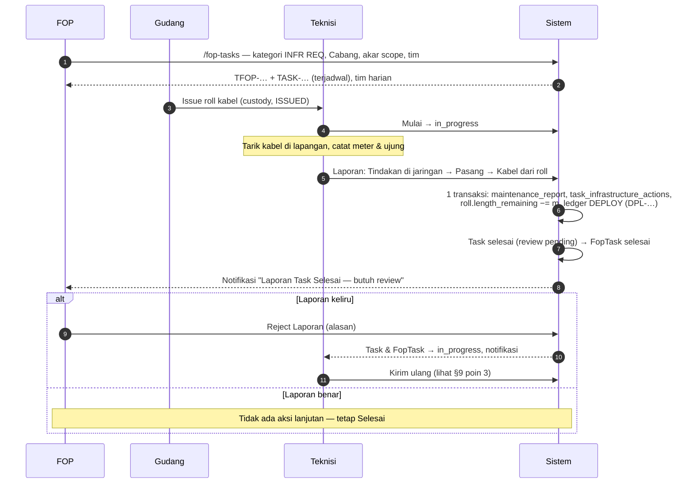

# Alur Laporan Pemasangan / Pergantian Kabel — Task INFR REQ

> Ditulis 2026-11-16 dari pembacaan kode `dev` (commit `2063fa9`). Dokumen ini
> **menjelaskan perilaku kode saat ini**, bukan rancangan baru. Kalau ada yang
> berbeda dengan rancangan di `docs/superpowers/specs/2026-10-12-laporan-oreq-infr-req-design.md`,
> yang berlaku adalah kode — perbedaannya dicatat di §9 "Celah & risiko".

## 0. Ringkasan

| Pertanyaan | Jawaban singkat |
|---|---|
| Siapa yang memulai? | **FOP**, lewat papan `/fop-tasks`, kategori **INFR REQ** (tidak bisa lewat Ticketing — `TaskType::ticketValues()` cuma MTN & C-REQ). |
| Kabelnya dari mana? | **Roll** kabel di **custody** tim teknisi, hasil Issue Gudang. Item roll wajib `ownership_mode = INFRASTRUCTURE_ASSET`. |
| Teknisi melapor di mana? | `GET /tasks/{task}/maintenance-report` → view `tasks/infrastructure-report.blade.php` (form khusus O-REQ/INFR REQ). |
| Aksi apa yang dipilih? | **"Pasang barang jaringan"** → jenis barang **"Kabel dari roll (meter)"**. Kalau kabel juga menyambung/melepas port: tambah aksi **"Sambung kabel antar node"** / **"Lepas sambungan kabel"**. |
| Kabel tercatat di mana? | (1) `inventory_rolls.length_remaining` berkurang, (2) satu baris ledger `inventory_transactions` tipe `DEPLOY` alasan `infra_cable_consumption` dengan lokasi `to_*`, (3) baris `task_infrastructure_actions` (lokasi kerja, ujung dari/ke, koordinat) + pivot ke transaksi. **Tidak** ada saldo di `infrastructure_balances` — kabel tidak punya "saldo terpasang". |
| Status FopTask setelah lapor? | Task → `selesai` + `fop_review_status = pending`; `TaskObserver` menyalin ke FopTask → **`selesai`** (riwayat `selesai`). Tidak ada tombol Approve untuk INFR REQ. FOP hanya bisa **Reject Laporan** → Task & FopTask balik ke `in_progress`. |
| Kabel lama (pergantian)? | Tidak ada aksi "cabut kabel" di mode **Tindakan di jaringan**. Pencabutan kabel hanya lewat mode **Koreksi / cabut material**, yang **tidak bisa digabung** dengan pemasangan dalam satu laporan. Lihat §5.2. |

---

## 1. Pihak yang terlibat

| Pihak | Peran di alur kabel | Halaman / kode |
|---|---|---|
| FOP | Buat Task FOP INFR REQ, pilih Cabang + akar scope lokasi, tugaskan tim, tinjau laporan. | `/fop-tasks` — `FopTaskController::store()`, `applyInfrastructureScope()` |
| Gudang | Issue roll kabel ke custody teknisi; menerima & memeriksa hasil cabut. | `/warehouse/issues/create` — `WarehouseIssueController`; `/warehouse/infrastructure-recoveries` |
| Teknisi | Mulai task, kerjakan di lapangan, isi laporan (meter terpakai, lokasi, ujung sambungan, bukti). | `/tasks/{task}` → `/tasks/{task}/maintenance-report` — `TaskMaintenanceController::report()/store()` |
| Sistem | Potong meter roll, tulis ledger, simpan baris aksi, selesaikan task, sinkron ke FopTask. | `TaskInfrastructureActionService`, `InventoryService::consumeInfrastructureRoll()`, `TaskService::complete()`, `TaskObserver` |

---

## 2. Prasyarat data (harus beres sebelum teknisi berangkat)

1. **Master Barang kabel** memakai `tracking_type = ROLL` dan `ownership_mode = INFRASTRUCTURE_ASSET`.
   Roll dengan ownership lain (mis. kabel drop pelanggan) **tidak muncul** di
   picker infrastruktur — `eligibleInfraRollsForTeam()` memfilter eksplisit,
   dan `consumeInfrastructureRoll()` menolaknya di server:
   `"Item … bukan aset infrastruktur (ownership_mode) — gak bisa di-deploy ke titik jaringan."`
2. **Roll sudah di-Issue** ke salah satu anggota tim (status `ISSUED`/`IN_USE`,
   `current_technician_id` = anggota tim, `length_remaining > 0`).
3. **Roll berasal dari Cabang yang sama** dengan task (`issued_from_pop_id` null
   atau = Cabang task). Roll cabang lain disaring dari picker dan ditolak di server.
4. **Struktur lokasi** (Mini POP → OLT/Switch → Slot → PON → ODP) sudah ada di
   Master Node, karena lokasi kerja dipilih dari dropdown bertingkat.

---

## 3. Alur FOP — membuat task

```
FOP buka /fop-tasks → Tambah Task
  ├─ Kategori        : INFR REQ  (TaskType::INFR, label "Infrastruktur Request")
  ├─ Cabang (POP)    : wajib
  ├─ Akar scope      : opsional, bertingkat — scope_mini_pop_id → scope_device_id
  │                    → scope_slot_id → scope_port_id → scope_odp_id
  ├─ Tugas / Issue   : uraian pekerjaan (mis. "Ganti kabel feeder ODC-03 → ODP-12 putus")
  ├─ Tanggal         : task_date
  └─ Teknisi         : satu atau beberapa
        │
        ▼  FopTaskController::store()  (satu DB::transaction)
  1. NumberSequenceService::fopTaskNumber()  → TFOP-YYYYMMDD-NNNNNN
  2. applyInfrastructureScope()              → simpan akar scope + scope_snapshot
  3. TaskService::create($taskData, $actor, $fopTask)
        → Task TASK-YYYYMMDD-NNNNNN, task_type = 'INFR REQ', status terjadwal
        → FopTask diteruskan sebagai sumber, supaya tidak terbentuk anchor
          FopTask kedua (regresi FopTaskInfraCreateDuplicateAnchorTest)
  4. fop_task.task_id = task.id
  5. FopTaskTeamService::rebuildTeamsForDate()  → tim harian + prefix judul
```

Catatan penting:

- **Akar scope = pagar lokasi.** Semua lokasi yang nanti dipilih teknisi wajib
  berada di irisan *izin POP teknisi ∩ Cabang task ∩ subtree akar scope*
  (`FopTaskInfrastructureScopeService::assertLocationInTaskScope()`). Kalau FOP
  memilih akar sampai Mini POP A1, teknisi tidak bisa mencatat kabel di Mini POP A2.
  Kalau akar kosong (cuma Cabang), seluruh pohon Cabang itu boleh.
- **INFR REQ boleh tanpa pelanggan.** Setiap Task O-REQ/INFR REQ dijamin punya
  tepat satu FopTask sebagai anchor ledger (`FopTaskProvisioningService::ensureForTask()`,
  unique `fop_tasks.task_id`). Kalau task lama belum punya anchor, anchor dibuat
  saat laporan dikirim, di dalam transaksi yang sama.
- **SLA:** `slaMinutes()` INFR = 480 menit (durasi pengerjaan),
  `defaultHandlingSlaHours()` = 72 jam (batas mulai ditangani). Dua konsep
  berbeda — lihat CLAUDE.md §SLA.

### 3.1 Gudang — issue roll

FOP/teknisi meminta kabel ke Gudang. Gudang mencatat **Issue** roll ke custody
teknisi (`/warehouse/issues/create`). Issue **belum** berarti terpasang; roll
tetap milik custody teknisi sampai meternya dipakai di laporan.

---

## 4. Alur teknisi — step by step

### 4.1 Sebelum isi laporan

1. Buka **Tasks Saya** → detail task `TASK-…` (status *Terjadwal*).
2. Tekan **Mulai** pada hari H → status **Sedang Dikerjakan** (`in_progress`).
   FopTask ikut `in_progress` lewat `TaskObserver`.
3. Kerjakan fisik di lapangan. Catat: dari titik mana ke titik mana kabel
   ditarik, berapa meter terpakai (selisih label meter roll), koordinat titik
   kerja bila perlu, foto hasil & foto pengukuran (OPM).
4. Kalau laporan belum bisa diisi di lokasi, boleh **Lapor Nanti**
   (`lapor_nanti`) — tim tetap menempel, task terkunci dari FOP, laporan
   tetap bisa dikirim nanti (`TaskStatus::acceptsReport()`).

### 4.2 Mengisi form "Laporan pekerjaan" (INFR-REQ)

Tombol laporan membuka `/tasks/{task}/maintenance-report`. Untuk O-REQ/INFR REQ
controller merender `tasks.infrastructure-report`, bukan form Maintenance biasa.

**Header "Tugas dari FOP"** — nomor task, wilayah, pekerjaan yang diminta
(read-only, dari issue FopTask).

**01 · Ringkasan pekerjaan** *(wajib, `kendala_teknis`)*
Tulis temuan, tindakan, hasil. Ini yang pertama dibaca FOP. Contoh:
> Kabel feeder ODC-03 → ODP-12 putus kena galian. Tarik kabel baru 85 m dari
> roll R-0012, sambung ulang di ODP-12 port 1. Redaman normal −19 dBm.

**02 · Apa yang dikerjakan?** — pilih **"Tindakan di jaringan"**.
(Dua pilihan lain: *Koreksi / cabut material* dan *Tanpa tindakan jaringan* —
lihat §5.2 dan §8.)

Klik **"+ Pasang barang jaringan"** → muncul satu baris aksi
(`action_type = install`, `action_key` = UUID baru dari browser). Isi:

| Field | Isi | Nama input | Wajib |
|---|---|---|---|
| Lokasi kerja (dropdown bertingkat) | Cabang → Mini POP → Perangkat (OLT/Switch) → Slot → PON → ODP. Pilih sampai titik **terdalam** tempat kabel dipasang. Level yang tidak relevan diisi "tidak ada" (`none`). | `infra_actions[i][loc_pop]` … `[loc_odp]` | Ya (INFR selalu wajib lokasi) |
| Jenis barang | **Kabel dari roll (meter)** | (UI) | Ya |
| Roll kabel | Roll dari custody tim — label `Nama barang · KODE-ROLL · sisa N m` | `infra_actions[i][roll_id]` | Ya |
| Meter terpakai | Panjang yang benar-benar dipakai, desimal 2 digit | `infra_actions[i][meters]` | Ya |
| Ujung sambungan dari | Salah satu level lokasi yang sudah dipilih (mis. `Perangkat · ODC-03`) | `infra_actions[i][end_from]` | Opsional |
| Ujung sambungan ke | Mis. `ODP · ODP-12` | `infra_actions[i][end_to]` | Opsional |
| Latitude / Longitude titik kerja | Berpasangan; −90..90 / −180..180 | `work_latitude`, `work_longitude` | Opsional |
| Hasil tindakan | Mis. "Kabel 85 m terpasang, redaman normal." | `infra_actions[i][result_note]` | Ya |

Aturan validasi baris kabel (`TaskInfrastructureActionService::validateActionFields()`):

- Satu baris *Pasang* = **tepat satu** barang (SN **atau** qty **atau** roll).
- `meters` wajib bila `roll_id` dipilih, dan sebaliknya.
- *Ujung sambungan* dan *koordinat* **hanya** boleh pada baris roll —
  `"Ujung sambungan dan koordinat hanya untuk pemakaian kabel."`
- Ujung dari/ke juga wajib berada dalam scope task (`parseEnd()` memakai guard yang sama).

**Kalau kabel juga menyambung/melepas port ODP** — tambah baris aksi terpisah:

- **"Sambung kabel antar node"** (`port_connect`): lokasi node (mis. ODP-12),
  *Port pada lokasi ini*, *Node tujuan*, *Port pada node tujuan*. Hasil:
  `NetworkPortAssignmentService::assignNode()` — port jadi terpakai. Stok tidak berubah.
- **"Lepas sambungan kabel"** (`port_release`): lokasi node + port yang sedang
  tersambung. Hasil: assignment dilepas dengan alasan `Laporan TFOP-…`. Ditolak
  kalau port memang tidak tersambung.

> Pemakaian kabel **tidak otomatis** mengubah port. Kalau port berubah secara
> fisik, wajib dicatat sebagai baris `port_connect`/`port_release` sendiri.

**Bagian pelanggan (opsional)** — `tasks.partials.customer-report-extra`, hanya
relevan kalau task INFR kebetulan menempel ke pelanggan. Kabel drop pelanggan
dicatat di sini (`selected_inventory_roll_id`), **bukan** di baris infrastruktur.
Barang/roll yang sama tidak boleh dicatat di dua seksi:
`"Barang, SN, atau roll yang sama tidak boleh dicatat melalui seksi material umum dan Infrastruktur."`

**03 · Bukti & alat kerja** — *Foto lokasi / hasil* (`opm_photo`), *Foto
pengukuran* (`speedtest_photo`), checklist alat kerja (opsional).

**04 · Tinjau laporan** — klik **Tinjau laporan**. Layar menampilkan ringkasan
tiap baris (lokasi · barang · hasil) + dampak stok:
*"Barang keluar dari custody tim dan tercatat di lokasi ini."*
Kalau sudah benar → **Kirim laporan & selesaikan task**.

### 4.3 Yang terjadi di server saat "Kirim"

`TaskMaintenanceController::store()` — **satu transaksi DB**; gagal di langkah
mana pun = seluruh laporan rollback, task tetap `in_progress`, meter roll utuh.

```
1. Validasi request (rule infra_actions.* hanya didaftarkan untuk O-REQ/INFR)
   + tolak campuran "baris aksi" dengan "form lama/koreksi"
   + tolak item/roll yang sama di dua seksi
2. DB::beginTransaction(); lock Task; authorize statusComplete ulang
3. maintenance_reports.create(kendala_teknis, foto)       ← ringkasan & bukti
4. FopTask anchor: resolveTaskFor() → kalau kosong ensureForTask()
5. TaskMaterialService::sync() / TaskWorkToolService::sync()  (material umum & alat)
6. TaskInfrastructureActionService::record(task, fopTask, infra_actions, tim, aktor)
     per baris:
       a. cek action_key unik dalam laporan
       b. mutation_hash = sha256(isi mutasi)
          - action_key sudah ada & hash sama  → lewati (idempoten), cuma update result_note
          - action_key sudah ada & hash beda  → tolak "Mutasi aksi lama berubah…"
       c. parse lokasi bertingkat → assertLocationInTaskScope()
       d. parse ujung end_from / end_to (scope sama)
       e. INSERT task_infrastructure_actions
       f. apply(): roll → InventoryService::consumeInfrastructureRoll()
            - lock roll; status ISSUED/IN_USE; custody tim; ownership INFRASTRUCTURE_ASSET
            - roll dari Cabang task; lokasi kerja di Cabang task
            - bandingkan dalam sentimeter integer (anti selisih float)
            - length_remaining -= meter; status IN_USE atau DEPLETED bila habis
            - INSERT inventory_transactions (DEPLOY, DPL-…, infra_cable_consumption)
       g. attach transaksi ke pivot task_infrastructure_action_transactions
7. TaskService::complete() → Task selesai, fop_review_status = pending
8. DB::commit() → redirect tasks.show "Laporan maintenance berhasil disimpan dan task diselesaikan."
   (setelah commit: broadcast TaskCompleted, notifikasi FOP satu POP)
```

---

## 5. Skenario

### 5.1 Pemasangan kabel baru (tidak ada kabel lama tercatat)

Satu laporan, mode **Tindakan di jaringan**:

| # | Aksi | Isi |
|---|---|---|
| 1 | Pasang barang jaringan | Lokasi: Cabang › Mini POP › ODC-03 › … › ODP-12 · Roll R-0012 · 85 m · dari `ODC-03` ke `ODP-12` · koordinat |
| 2 | Sambung kabel antar node *(kalau port berubah)* | Node ODP-12 · port 1 → node tujuan · port tujuan |

Hasil: roll R-0012 berkurang 85 m, satu baris ledger DEPLOY, dua baris aksi.

### 5.2 Pergantian kabel (kabel lama diganti kabel baru)

"Ganti" pada form (`replace`) **hanya untuk perangkat ber-SN** — tidak berlaku
untuk kabel. Pergantian kabel terdiri dari dua kejadian yang di sistem dicatat
lewat jalur berbeda:

**a. Kabel baru** → sama persis §5.1 (*Pasang barang jaringan* → *Kabel dari roll*).
Tulis di *Ringkasan* dan *Hasil tindakan* bahwa ini pengganti kabel lama yang
putus/rusak.

**b. Kabel lama** — tergantung kondisi:

| Kondisi kabel lama | Yang dicatat | Keterangan |
|---|---|---|
| Kabel lama **tidak pernah tercatat** di sistem (kabel legacy, sebelum ada ledger) | Cukup dituliskan di Ringkasan + foto. | Tidak ada transaksi asal untuk dibalik; jangan mengarang pencabutan. |
| Kabel lama **ditinggal / dibuang** di lapangan (putus, tak layak) | Cukup dituliskan di Ringkasan + foto. | Kabel tidak punya saldo terpasang (§6), jadi tidak ada saldo node yang "nyangkut". |
| Kabel lama **dulu dipasang lewat laporan O-REQ/INFR** dan **benar-benar dibawa pulang** untuk diperiksa Gudang | Mode **Koreksi / cabut material** → *Cabut material dari jaringan*. | Lihat batasan di bawah. |

Form **Koreksi / cabut material** (`infra_material_action = retrieve`):

- *Transaksi pemasangan asal* — pilih DEPLOY kabel lama (daftar cuma memuat
  DEPLOY non-SN yang lokasinya **node** di Cabang task).
- *Jumlah yang dicabut* — meter; tidak boleh melebihi sisa terpasang dari transaksi asal.
- *Alasan* — wajib.
- Hasil: `InfrastructureMaterialService::retrieve()` menulis ledger
  `RETRIEVE_INFRA` (`RTR-…`, ke custody pelaksana) + `infrastructure_recoveries`
  status `pending_inspection`. Gudang lalu memeriksa di
  `/warehouse/infrastructure-recoveries` (layak pakai → potongan dengan identitas
  roll baru; rusak → penyesuaian/afkir). Panjang roll asal **tidak** bertambah.

**Batasan penting:** satu laporan hanya bisa memakai **satu jalur** —
*Tindakan di jaringan* **atau** *Koreksi / cabut material*. Server menolak
gabungan: `"Pilih satu jalur laporan Infrastruktur: baris aksi atau form lama."`
Dan laporan pertama langsung menyelesaikan task. Jadi kalau kabel lama memang
harus dicatat dicabut **dan** kabel baru dicatat terpasang, praktik yang aman saat ini:

1. FOP membuat **dua task** INFR REQ: satu untuk cabut kabel lama (laporan mode
   Koreksi/cabut), satu untuk pasang kabel baru (laporan mode Tindakan), **atau**
2. Satu task untuk pasang kabel baru; pencabutan kabel lama dilaporkan lewat
   task INFR REQ terpisah setelahnya.

(Celah ini dicatat di §9.)

### 5.3 Salah catat meter / lokasi setelah terkirim

Jangan kirim ulang baris *Pasang* dengan angka berbeda. Pakai **Koreksi /
cabut material** → *Koreksi jumlah / lokasi* (`InfrastructureMaterialService::correct()`
/ `correctRoll()`): merujuk DEPLOY asal, membuat catatan pembalik + catatan
benar, wajib alasan. Ledger lama tidak dihapus (append-only).

---

## 6. Di mana kabel tercatat

### 6.1 Tabel yang ditulis

| Tabel | Kolom penting | Isi untuk pemakaian kabel |
|---|---|---|
| `inventory_rolls` | `length_remaining`, `status`, `current_technician_id` | Sisa meter dikurangi. `IN_USE`, atau `DEPLETED` bila habis. Roll **tetap** di custody teknisi — yang "pindah" ke jaringan hanya meter yang dipotong. |
| `inventory_transactions` | `type = DEPLOY`, `reference_number = DPL-…`, `item_id`, `roll_id`, `lot_no = roll_code`, `qty` = meter, `unit_price_snapshot`, `from_technician_id`, `to_infrastructure_pop_id` / `to_mini_pop_id` / `to_network_node_id` / `to_infrastructure_slot_id` / `to_infrastructure_port_id` (hanya level terdalam yang terisi), `to_pop_id` = snapshot Cabang, `fop_task_id`, `reason = infra_cable_consumption`, `notes` = "85 meter dari roll R-0012 dipakai di … (Task TFOP-…)" | **Sumber kebenaran** pemakaian kabel. Append-only. |
| `task_infrastructure_actions` | `task_id`, `fop_task_id`, `action_key`, `action_type = install`, `work_pop_id` / `network_node_id` / `work_infrastructure_slot_id` / `work_infrastructure_port_id`, `work_location_snapshot`, `end_from_*`, `end_to_*`, `work_latitude/longitude`, `mutation` (JSON), `mutation_hash`, `scope_snapshot`, `result_note`, `performed_by`, `performed_at` | Konteks lapangan: lokasi kerja, **ujung sambungan dari/ke**, koordinat, siapa & kapan. Ujung sambungan **hanya** disimpan di sini, tidak di ledger. |
| `task_infrastructure_action_transactions` | pivot aksi ↔ transaksi | Menghubungkan baris aksi ke DEPLOY `DPL-…`. |
| `maintenance_reports` | `kendala_teknis`, `opm_photo`, `speedtest_photo` | Ringkasan & bukti foto. Kolom `kabel` **tidak** diisi form INFR. |
| `network_port_assignments` | — | Hanya berubah bila ada baris `port_connect`/`port_release`. |
| `infrastructure_balances` | — | **Tidak ditulis** untuk kabel. Docblock `consumeInfrastructureRoll()`: kabel tidak punya "saldo terpasang"; saldo kabel yang sah cuma sisa roll. (Barang qty seperti closure/sleeve yang memakai `deployQuantityAt()` *punya* saldo di sini.) |

### 6.2 Tempat melihatnya

| Halaman | Apa yang terlihat | Sumber |
|---|---|---|
| Detail Task `/tasks/{task}` → **Rincian tindakan** | Jenis aksi, teknisi, waktu, lokasi, dampak aset, hasil, "Catatan barang": `Deploy: <kabel> · 85 m (DPL-…)` | `tasks.partials.infra-action-review` |
| **Stok Infra** `/warehouse/infra-stock` (`warehouse.infra_stock.view`) | Akumulasi meter kabel per barang × kombinasi lokasi (node/slot/port/POP), dijumlah dari ledger DEPLOY roll | `WarehouseInfraStockController::paginateRoll()` |
| **Peta Infrastruktur** `/network/peta` → node → Barang Terpasang | Baris ROLL per node + link ke Traceability roll | `InfrastructureMapService` (grup per `to_network_node_id`) |
| **Traceability** `/warehouse/traceability?roll=KODE` | Riwayat roll: receive → issue → deploy → (retrieve) | `WarehouseTraceabilityController` |
| Stok roll `/warehouse/stock/rolls` | Sisa meter roll di custody | `WarehouseStockController::rolls()` |

---

## 7. Status FopTask setelah laporan dikirim

### 7.1 Transisi

```
Task.status        : in_progress (atau lapor_nanti)  ──complete()──▶  selesai
Task.fop_review_status : null                         ──────────────▶  pending
        │
        ▼ TaskObserver::updated()  (status/fop_review_status berubah)
FopTask.status     : in_progress                      ──────────────▶  selesai
fop_task_status_history : from=in_progress, to='selesai'
```

`TaskObserver::resolveTarget()`: untuk task **selain** Survey/PSB, label riwayat
langsung `selesai` — **tidak ada** langkah Approve (keputusan user 2026-09-28,
tombol Approve Task untuk non-Survey/PSB dihapus). Di papan FOP task masuk
kolom **Selesai**. Badge "Perlu Review" (`FopTask::verificationStatus()`) hanya
untuk Survey/Pemasangan, jadi INFR REQ tidak mendapat badge itu.

Efek samping `TaskService::complete()`:
- `completed_at`, `completed_by`, `work_finished_at` (dipertahankan bila dari Lapor Nanti).
- Broadcast `TaskCompleted` (realtime dashboard FOP).
- Notifikasi in-app ke user role `fop` yang scope-nya mencakup POP task:
  *"Laporan Task Selesai: TASK-… — … Butuh review Anda."*
- `AuditLog` `completed`.

### 7.2 Review oleh FOP

Di detail task, FOP (policy `review`: status `selesai` & review ≠ `approved`)
melihat panel **"Laporan Teknisi (Khusus FOP)"** dengan satu tombol:
**Reject Laporan** (wajib alasan).

| Aksi FOP | Task | FopTask | Stok / ledger |
|---|---|---|---|
| Tidak melakukan apa pun | `selesai`, review `pending` (permanen) | `selesai` | Tetap — pemasangan sudah tercatat saat teknisi melapor. |
| **Reject Laporan** | `in_progress`, review `rejected`, `reject_reason` terisi; tim dapat notifikasi | `in_progress` (riwayat `in_progress`) | **Tidak dibalik.** Persetujuan FOP adalah quality gate laporan, bukan perintah kedua untuk mengubah stok. |
| Pending (endpoint `action=pending`, tidak ada tombolnya di panel non-Survey/PSB) | `pending`, tim dilepas, kembali ke antrean FOP | `pending` | Tidak dibalik. |

Setelah Reject, teknisi membuka form laporan lagi dan mengirim ulang.
**Lihat peringatan §9 poin 3** sebelum mengisi ulang baris kabel.

---

## 8. Diagram alur ringkas



---

## 9. Celah & risiko yang ditemukan dari kode (belum diperbaiki)

Dicatat sebagai temuan, bukan diperbaiki di dokumen ini. Perbaikan perlu task tersendiri.

1. **Pergantian kabel tidak bisa dicatat utuh dalam satu laporan.**
   Pasang kabel baru (mode *Tindakan*) dan cabut kabel lama (mode *Koreksi /
   cabut*) saling eksklusif di server (`TaskMaintenanceController::store()`
   baris "Pilih satu jalur laporan Infrastruktur"), sementara laporan pertama
   langsung menyelesaikan task. Solusi jangka pendek: dua task (§5.2).
   Solusi permanen: aksi baris `retrieve` untuk roll/qty di mode *Tindakan*.
2. **Pencabutan kabel hanya untuk kabel yang dulu dipasang lewat laporan
   O-REQ/INFR** dan yang lokasi DEPLOY-nya node — daftar *Transaksi pemasangan
   asal* memfilter `to_network_node_id` tidak null. Kabel yang dicatat di
   Slot/PON/Port/POP tidak muncul sebagai sumber cabut/koreksi.
3. **Kirim ulang setelah Reject bisa memotong roll dua kali.** Form mengisi
   baris aksi hanya dari `old('infra_actions')` (input gagal validasi), bukan
   dari aksi yang sudah tersimpan. Setelah Reject, form terbuka kosong; bila
   teknisi menambah lagi baris *Pasang kabel*, browser membuat `action_key` UUID
   **baru** → idempotensi tidak berlaku → DEPLOY kedua dan meter roll terpotong
   lagi. Panduan sementara: saat kirim ulang karena bukti/uraian kurang, pilih
   **"Tanpa tindakan jaringan"** dan perbaiki Ringkasan/foto saja; kalau angkanya
   yang salah, pakai *Koreksi jumlah / lokasi*. Setiap kirim ulang juga menambah
   satu baris `maintenance_reports` baru.
4. **Review FOP kurang lengkap untuk kabel.** `infra-action-review` menampilkan
   lokasi dari `network_node_id` saja — kabel yang lokasi terdalamnya POP/Mini
   POP/Slot/Port tampil sebagai *"Pekerjaan kantor / tanpa node"*. Ujung
   sambungan dari/ke dan koordinat yang disimpan di `task_infrastructure_actions`
   tidak ditampilkan di review.
5. **Tidak ada tombol Approve** untuk INFR REQ; `fop_review_status` tetap
   `pending` selamanya kecuali di-Reject. Bukan bug (keputusan 2026-09-28), tapi
   artinya "sudah ditinjau FOP" tidak bisa dibedakan dari "belum dilihat".
6. **Biaya kabel tidak masuk tagihan.** `unit_price_snapshot` ikut tercatat di
   ledger, tapi O-REQ/INFR REQ sengaja tidak masuk antrean Verifikasi Biaya
   (komentar di `store()`, finding 2026-10-10).

---

## 10. Rujukan kode

| Kebutuhan | File |
|---|---|
| Form laporan & validasi | `app/Http/Controllers/TaskMaintenanceController.php` (`report()`, `store()`, `eligibleInfraRollsForTeam()`) |
| View | `resources/views/tasks/infrastructure-report.blade.php`, `partials/infra-location-picker.blade.php`, `resources/js/task-infrastructure-report.js` |
| Baris aksi | `app/Services/TaskInfrastructureActionService.php`, `app/Models/TaskInfrastructureAction.php` |
| Potong roll & ledger | `app/Services/InventoryService.php` (`consumeInfrastructureRoll()`, `deployRoll()`) |
| Koreksi / cabut | `app/Services/InfrastructureMaterialService.php` (`correct()`, `correctRoll()`, `retrieve()`, `inspect()`) |
| Scope lokasi | `app/Services/FopTaskInfrastructureScopeService.php`, `app/Services/InfrastructureReportLocationParser.php` |
| Anchor FopTask | `app/Services/FopTaskProvisioningService.php` (`ensureForTask()`) |
| Selesai & sinkron FopTask | `app/Services/TaskService.php` (`complete()`), `app/Observers/TaskObserver.php` (`resolveTarget()`) |
| Review FOP | `app/Http/Controllers/TaskController.php` (review), `resources/views/tasks/show.blade.php`, `partials/infra-action-review.blade.php` |
| Rancangan asal | `docs/superpowers/specs/2026-10-12-laporan-oreq-infr-req-design.md` |
| Test terkait | `tests/Feature/TaskInfrastructureHierarchicalLocationTest.php`, `tests/Feature/TaskInfrastructureDeployReportTest.php` |
